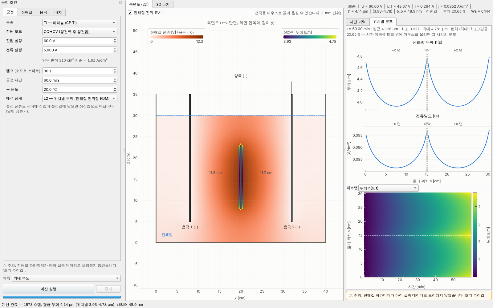
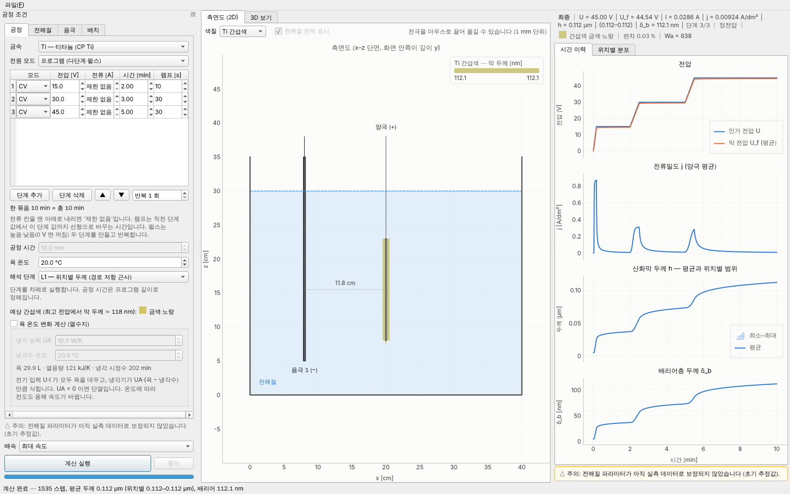
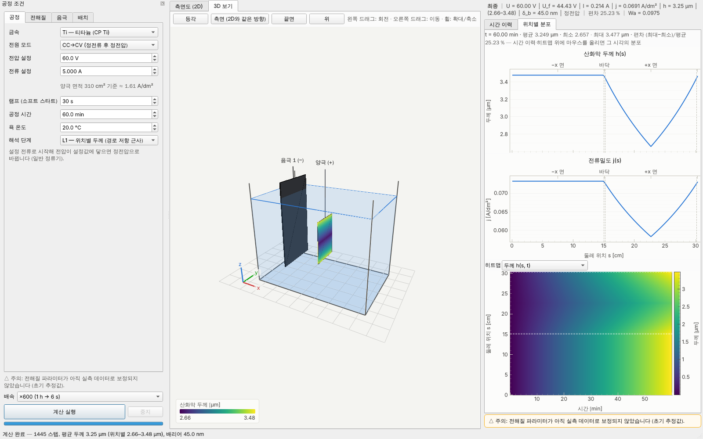
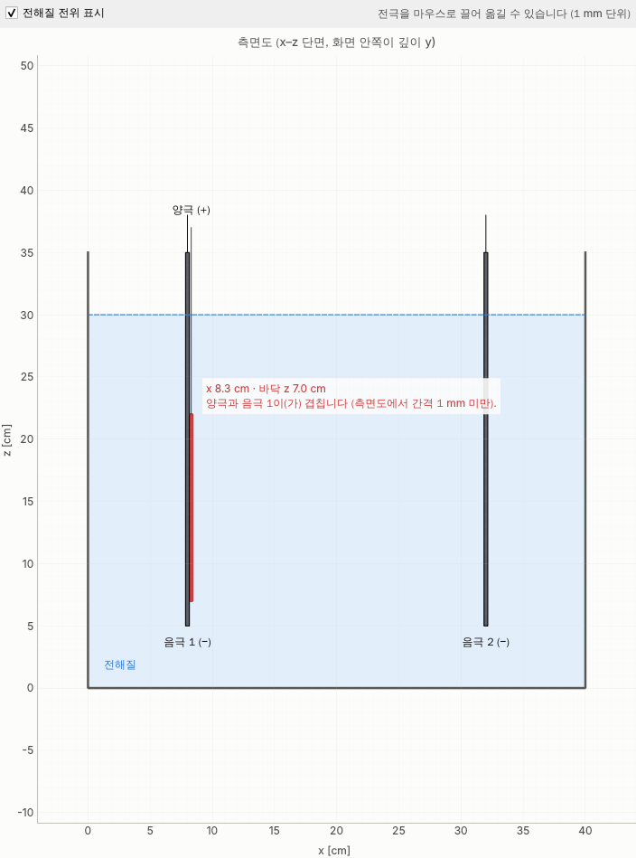

# Anodizing_simulator
TiO2, Al2O3 아노다이징 공정을 시뮬레이션 해줄 수 있는 시뮬레이터 개발

전압·전류·전해질 레시피·음극재·공정 시간·전극 배치를 입력하면 산화막(Al₂O₃, TiO₂) 두께가 시간에 따라 어떻게 자라는지 계산해 그래프로 보여주는 GUI 프로그램입니다. 대상은 순수 Al(1xxx 계열)과 CP Ti 이며 합금은 다루지 않습니다.

- 설계 문서: [docs/DESIGN.md](docs/DESIGN.md) (수학 모델, 아키텍처, 검증 결과, 로드맵)
- 현재 단계: **P0–P4 완료** — L0(양극 평균)·L1(경로 근사)·L2(전해질 전위장 FDM) 물리 엔진, 프로그램 전원(다단계·펄스), 욕 열수지, Ti 간섭색, GUI(측면도 2D·전극 끌어 놓기·전위장·마우스 회전 3D·실시간 결과 그래프·양극 두께/간섭색 색칠·프로파일·히트맵·프로젝트 저장/열기·내보내기), CLI, 테스트 168개
- 다음 단계(P5): 실측 두께-시간 데이터로 전해질 파라미터 보정 (데이터 확보 후)







## 설치

Python 3.11 이상.

```bash
pip install -r requirements.txt          # numpy, scipy, PyQt6, pyqtgraph, PyOpenGL
pip install -e .                          # anodsim 패키지 설치 (src/ 레이아웃)
```

## 실행

```bash
python -m anodsim                         # GUI
python -m anodsim.cli --list              # 프리셋 목록
python -m anodsim.cli --metal Al --mode CCCV --voltage 15 --current 5 --minutes 60
python -m anodsim.cli --metal Ti --electrolyte ti_color_acid --mode CV --voltage 50 --minutes 10 --csv ti.csv
python -m anodsim.cli --metal Ti --electrolyte ti_nanotube_eg --mode CV --voltage 60 --one-cathode --profile-csv profile.csv
python -m anodsim.cli --fidelity L0 --mode CV --voltage 15         # 양극 평균만 (빠른 추정)
python -m anodsim.cli --metal Ti --electrolyte ti_nanotube_eg --mode CV --voltage 60 --fidelity L2   # 전위장 FDM
python -m anodsim.cli --electrolyte al_sulfuric_hard --mode CCCV --voltage 60 --current 10 --temperature 0 \
       --cooling 20 --save-project 경질.anod.json        # 열수지 (냉각 UA 20 W/K) + 프로젝트 저장
python -m anodsim.cli --project 경질.anod.json --csv 경질.csv   # 저장한 프로젝트로 다시 계산
```

CLI 는 기본으로 L1(위치별) 계산을 하며, 끝에 평균·최소·최대 두께와 편차, Wagner 수를 출력합니다. `--fidelity L2` 는 FDM 격자 크기도 함께 출력합니다. `--cooling` 을 주면 욕 온도 변화(열수지)를 계산해 시작·끝 온도를 보여주고, Ti 치밀막은 예상 간섭색을 출력합니다. `--profile-csv` 는 최종 위치별 분포(둘레 위치 s, 면, 두께, 전류밀도)를, `--csv` 는 시간 이력(욕 온도·전원 단계 포함)을 저장합니다. 다단계·펄스 전원은 프로젝트 파일(아래)에 적어 `--project` 로 실행합니다.

GUI 사용법:

1. 왼쪽 '공정 조건'에서 금속·전원 모드·전압·전류·시간·온도·해석 단계(공정 탭), 전해질 프리셋·농도(전해질 탭), 음극재(음극 탭), 전해조·전극 위치(배치 탭)를 정합니다. 해석 단계는 세 가지입니다.
   - **L0**: 양극 평균만 빠르게 계산합니다.
   - **L1 (기본)**: 위치별 두께를 경로 저항 근사로 계산합니다.
   - **L2**: 측면도 단면의 전해질 전위장을 FDM 으로 풀어 위치별 두께를 계산합니다. 판 끝 전류 집중, 요소 사이 전위 결합, 음극 뒷면까지 반영합니다. 처음 한 번 격자 풀이에 0.2초 정도 더 걸립니다.
2. 가운데 **측면도(2D)** 가 기본 보기입니다. **양극·음극을 마우스로 끌어 옮길 수 있습니다** (1 mm 단위). 끄는 동안 위치가 표시되고, 겹치거나 벽·바닥에 너무 가까운 자리면 테두리가 빨갛게 바뀌며 이유가 나옵니다. 놓으면 배치 탭 입력 칸에 그대로 반영됩니다. **3D 보기** 탭에서는 왼쪽 드래그로 회전, 오른쪽(또는 가운데) 드래그로 이동, 휠로 확대/축소합니다. 시점 버튼(등각·측면·끝면·위)으로 바로 돌아갈 수 있습니다.
3. **배속**(최대 속도, ×3600 … ×1)을 고르고 '계산 실행'을 누르면 계산하는 동안 그래프가 실시간으로 그려집니다. 측면도와 3D 보기의 양극 표면은 두께에 따라 색이 칠해집니다. L2 로 계산하면 측면도의 전해질이 전위(음극 = 0 V)에 따라 주황색으로 칠해지며, 위쪽 '전해질 전위 표시'로 끄고 켤 수 있습니다. 배속은 계산 중에도 바꿀 수 있습니다.
4. 전원 모드에서 **프로그램 (다단계·펄스)** 을 고르면 단계 표가 나옵니다. 단계마다 모드·전압·전류·시간·램프를 적고, 묶음 전체의 **반복 횟수**를 정합니다. 예를 들어 다단 승압은 15 V → 30 V → 45 V 단계를 차례로 적습니다. 펄스는 20 V 30 s 와 0 V 30 s(꺼짐) 두 단계를 만들고 반복 횟수를 늘립니다. 공정 시간은 프로그램 길이로 정해집니다.
5. **욕 온도 변화 계산 (열수지)** 를 체크하면 전기 입력 U·I 가 욕을 데우고, 냉각기가 UA·(욕 온도 − 냉각수 온도)만큼 식힙니다. 계산 중 욕 온도에 따라 전도도·용해 속도가 바뀌고, 결과에 욕 온도 그래프가 추가됩니다. 프리셋 검증 범위를 벗어나면 경고가 뜹니다.
6. Ti 착색(묽은 황산) 같은 Ti 치밀막은 공정 탭에 **예상 간섭색**이 보입니다. 계산 결과도 측면도·3D 양극 표면을 막 두께에 따른 간섭색으로 칠하고(측면도 위 '색칠'에서 두께 색상표로 바꿀 수 있음), 판독 줄에 색 견본이 나옵니다. 색은 박막 간섭 + CIE 표준 관찰자로 계산한 근사입니다.
7. **파일** 메뉴에서 지금 입력을 프로젝트 파일(`*.anod.json`)로 저장하고 다시 열 수 있습니다. 내보내기로 시간 이력·위치별 분포 CSV 와 결과 그래프·측면도·3D 그림(PNG)을 저장합니다.
8. 오른쪽 **시간 이력** 탭에는 전압, 전류밀도, 산화막 두께(평균과 위치별 최소–최대 범위), 배리어층 두께가 나옵니다. **위치별 분포** 탭에는 양극 둘레 위치 s(−x 면 → 바닥 → +x 면 → 윗면)에 따른 두께·전류밀도와 히트맵 h(s, t)가 나옵니다. 히트맵은 '평균 대비 편차'로 바꿔 볼 수 있습니다. 시간 이력 위에 마우스를 올리면 그 시각의 값, 분포, 색칠이 따라 바뀝니다.

> L1 은 전극 사이 거리·높이 차이, 한쪽 음극일 때 등진 면이 얇아지는 현상, 판 끝이 두꺼워지는 현상을 근사합니다. L2 는 이것에 더해 모서리 전류 집중을 잡아, 전도도가 낮은 전해질(TiO₂ 나노튜브)에서 판 끝이 가운데보다 20 % 정도 두껍게 나옵니다. 두 단계 모두 측면도 단면이 깊이(y) 방향으로 균일하다고 가정합니다.



## 프로젝트 파일 (`*.anod.json`)

공정 설정 전체를 사람이 읽을 수 있는 JSON 으로 저장합니다. 단위는 키 이름에 붙어 있고(cm, mm, °C, min, s, V, A, W/K), '제한 없음' 전류는 `null` 입니다. 예를 들어 펄스 아노다이징 전원은 다음과 같이 씁니다.

```json
"power": {"program": {"repeat": 30, "steps": [
  {"mode": "CV", "voltage_V": 20.0, "current_A": null, "duration_min": 0.5, "ramp_s": 0.0},
  {"mode": "CV", "voltage_V": 0.0,  "current_A": null, "duration_min": 0.5, "ramp_s": 0.0}
]}},
"thermal": {"cooling_W_per_K": 20.0, "coolant_temperature_C": 18.0}
```

GUI 에서 저장한 파일을 고쳐 CLI(`--project`)로 돌리거나, 그 반대로 쓸 수 있습니다. 형식 전체는 [docs/DESIGN.md](docs/DESIGN.md) §2.10 과 `src/anodsim/io/project.py` 머리말에 있습니다.

## 포함된 프리셋

| 금속 | 전해질 | 성장 모드 |
|---|---|---|
| Al | 황산 Type II, 황산 경질(Type III), 옥살산, 인산 | 다공성 |
| Al | 붕산염 배리어형 | 치밀 |
| Ti | 묽은 황산 착색 | 치밀 |
| Ti | EG + NH₄F 나노튜브 | 다공성 |

음극재: Pb, Al, SUS316, Ti, 흑연, Pt. 프리셋은 `src/anodsim/data/*.json` 에서 코드 수정 없이 추가·수정할 수 있습니다.

> 전해질 파라미터는 공정 범위 기반의 **초기 추정값**입니다(`calibrated: false`). 실측 두께-시간 데이터를 확보하면 보정 단계(P5)에서 맞출 예정이며, 그 전까지 GUI·CLI 는 이를 '주의'로 표시합니다.

## 테스트

```bash
pip install -r requirements-dev.txt
pytest                                    # 디스플레이가 없으면 Qt offscreen 플랫폼으로 GUI 테스트 실행
```

## 구조

```text
src/anodsim/
  core/    물리 엔진 (Qt 비의존): 패러데이·고전계 성장 모델, 회로 해석, 시간 적분, 프리셋 로더,
           field/ (양극 표면 이산화, L1 경로 저항, L2 FDM 저항 행렬·전위장),
           power_supply (다단계 프로그램), thermal (욕 열수지), optics (Ti 간섭색)
  data/    금속·전해질·음극재 프리셋 JSON
  io/      프로젝트 파일(*.anod.json) 저장·불러오기, 결과 CSV 내보내기
  gui/     PyQt6 + PyQtGraph: 입력 패널(프로그램 편집기·열수지), 측면도(전극 끌어 놓기·전위장), 3D 보기,
           결과 그래프(시간 이력·위치별 분포), 파일 메뉴, 워커 스레드
  cli.py   GUI 없이 계산·CSV 저장
tests/     pytest (core + pytest-qt GUI)
```
