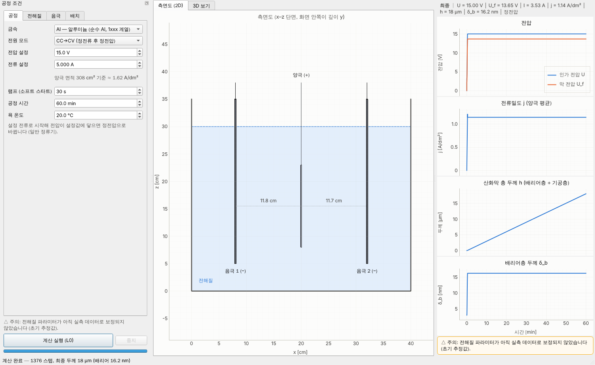

# Anodizing_simulator
TiO2, Al2O3 아노다이징 공정을 시뮬레이션 해줄 수 있는 시뮬레이터 개발

전압·전류·전해질 레시피·음극재·공정 시간·전극 배치를 입력하면 산화막(Al₂O₃, TiO₂) 두께가 시간에 따라 어떻게 자라는지 계산해 그래프로 보여주는 GUI 프로그램입니다. 대상은 순수 Al(1xxx 계열)과 CP Ti 이며 합금은 다루지 않습니다.

- 설계 문서: [docs/DESIGN.md](docs/DESIGN.md) (수학 모델, 아키텍처, 검증 결과, 로드맵)
- 현재 단계: **P0·P1 완료** — L0(0D) 물리 엔진, GUI(측면도 2D·마우스 회전 3D·결과 그래프), CLI, 테스트 73개
- 다음 단계(P2): 양극 표면 위치별 두께 h(s, t), 실시간 갱신, 3D 양극 표면 두께 색칠



## 설치

Python 3.11 이상.

```bash
pip install -r requirements.txt          # numpy, scipy, PyQt6, pyqtgraph, PyOpenGL
pip install -e .                          # anodsim 패키지 설치 (src/ 레이아웃)
```

## 실행

```bash
python -m anodsim                         # GUI
python -m anodsim.cli --list              # 프리셋 목록
python -m anodsim.cli --metal Al --mode CCCV --voltage 15 --current 5 --minutes 60
python -m anodsim.cli --metal Ti --electrolyte ti_color_acid --mode CV --voltage 50 --minutes 10 --csv ti.csv
```

GUI 사용법:

1. 왼쪽 '공정 조건'에서 금속·전원 모드·전압·전류·시간·온도(공정 탭), 전해질 프리셋·농도(전해질 탭), 음극재(음극 탭), 전해조·전극 위치(배치 탭)를 정합니다.
2. 가운데 **측면도(2D)** 가 기본 보기입니다. **3D 보기** 탭에서는 왼쪽 드래그로 회전, 오른쪽(또는 가운데) 드래그로 이동, 휠로 확대/축소합니다. 시점 버튼(등각·측면·끝면·위)으로 바로 돌아갈 수 있습니다.
3. '계산 실행 (L0)'을 누르면 오른쪽에 전압, 전류밀도, 산화막 두께, 배리어층 두께가 시간축으로 그려집니다. 그래프 위에 마우스를 올리면 그 시각의 값이 위쪽 판독 줄에 표시됩니다.

## 포함된 프리셋

| 금속 | 전해질 | 성장 모드 |
|---|---|---|
| Al | 황산 Type II, 황산 경질(Type III), 옥살산, 인산 | 다공성 |
| Al | 붕산염 배리어형 | 치밀 |
| Ti | 묽은 황산 착색 | 치밀 |
| Ti | EG + NH₄F 나노튜브 | 다공성 |

음극재: Pb, Al, SUS316, Ti, 흑연, Pt. 프리셋은 `src/anodsim/data/*.json` 에서 코드 수정 없이 추가·수정할 수 있습니다.

> 전해질 파라미터는 공정 범위 기반의 **초기 추정값**입니다(`calibrated: false`). 실측 두께-시간 데이터를 확보하면 보정 단계(P5)에서 맞출 예정이며, 그 전까지 GUI·CLI 는 이를 '주의'로 표시합니다.

## 테스트

```bash
pip install -r requirements-dev.txt
pytest                                    # 디스플레이가 없으면 Qt offscreen 플랫폼으로 GUI 테스트 실행
```

## 구조

```text
src/anodsim/
  core/    물리 엔진 (Qt 비의존): 패러데이·고전계 성장 모델, 회로 해석, 시간 적분, 프리셋 로더
  data/    금속·전해질·음극재 프리셋 JSON
  gui/     PyQt6 + PyQtGraph: 입력 패널, 측면도, 3D 보기, 결과 그래프, 워커 스레드
  cli.py   GUI 없이 계산·CSV 저장
tests/     pytest (core + pytest-qt GUI)
```
