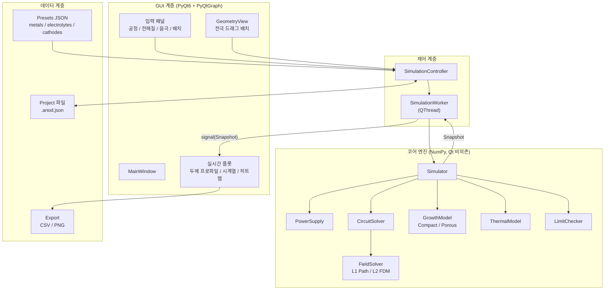
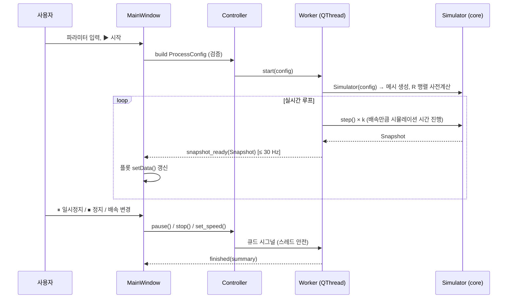

# 아노다이징 시뮬레이터 설계서 (v0.1)

> 대상: Al → Al₂O₃, Ti → TiO₂ 아노다이징 공정의 **위치별·시간별 산화막 두께** 예측
> 스택: Python 3.11+, PyQt6, NumPy, PyQtGraph (+ SciPy 권장, §2.11 참고)
> 상태: 설계 초안. 아래 수치 파라미터는 **초기 추정값**이며 실험 데이터로 보정(calibration)하는 것을 전제로 한다.

---

## 0. 개요

### 0.1 목표
사용자가 입력한 공정 조건으로 산화막 두께 분포 $h(s, t)$를 계산하고 실시간으로 시각화한다. 여기서 $s$는 양극(피처리물) 표면을 따라가는 위치 좌표다. 입력 조건은 다음과 같다.

- 전원: 전압 $U$, 전류 $I$ (정전압 / 정전류 / 정전류→정전압)
- 전해질 레시피: 산 종류·농도, 첨가제(NH₄F, 에틸렌글리콜 등), 욕 온도
- 음극재: Pb, SUS316, Al, Ti, Pt, 흑연 등
- 공정 시간 $t$
- 양극·음극의 배치: 전해조 크기, 전극 형상, 위치, 면적

### 0.2 모델 충실도 단계 (Level)

한 번에 모든 물리를 넣지 않고, 같은 인터페이스 위에서 단계적으로 정밀도를 올린다.

| Level | 공간 차원 | 전류 분포 계산 | 용도 |
|---|---|---|---|
| **L0** | 0D (한 점) | 없음 (단일 저항) | 공정 조건 빠른 추정, 단위 테스트 기준값 |
| **L1** | 양극 표면 1D ($s$) | 경로 저항 근사 (대각 행렬 $R$) | 실시간 미리보기 (기본값) |
| **L2** | 전해조 2D 단면 | 라플라스 방정식 FDM → 전해질 저항 행렬 $R$ (2차 전류 분포) | 전극 배치 효과 정밀 분석 |
| L3 (향후) | 3D, 열·유동 연성 | FEM/BEM | 연구용 확장 |

L1과 L2의 차이는 **저항 행렬 $R$을 어떻게 만드는가**뿐이다. 성장 모델, 회로 해석기, GUI는 그대로 재사용한다(§1.7).

---

## 1. 수학 모델

### 1.1 기호와 단위

내부 계산은 모두 SI 단위다. 표시할 때만 μm, nm, min, A/dm²로 변환한다.

| 기호 | 의미 | 단위 |
|---|---|---|
| $F$ | 패러데이 상수 (96485.332) | C/mol |
| $R_g$ | 기체 상수 (8.314) | J/(mol·K) |
| $j$ | 양극 국부 전류밀도 | A/m² |
| $\eta$ | 전류효율 (산화막 형성에 쓰인 전하 비율) | – |
| $M_{ox}, \rho_{ox}$ | 산화물 몰질량, 밀도 | kg/mol, kg/m³ |
| $z$ | 산화물 1 화학식단위당 전자 수 (Al₂O₃: 6, TiO₂: 4) | – |
| $k_F$ | 패러데이 성장 계수 $M_{ox}/(zF\rho_{ox})$ | m³/C |
| $\delta_b$ | 배리어(치밀)층 두께 | m |
| $h_p$ | 다공성층(또는 나노튜브) 두께 | m |
| $h$ | 총 산화막 두께 $= \delta_b + h_p$ | m |
| $P$ | 다공성층 기공률 | – |
| $U_f$ | 산화막에 걸리는 전압 | V |
| $E = U_f/\delta_b$ | 배리어층 내부 전계 | V/m |
| $A, B$ | 고전계 이온전도 상수 | A/m², m/V |
| $\kappa$ | 전해질 전도도 | S/m |
| $T$ | 욕 온도 | K |

### 1.2 전기화학 반응과 패러데이 법칙

**양극 반응 (산화막 형성)**

```math
2\,\mathrm{Al} + 3\,\mathrm{H_2O} \rightarrow \mathrm{Al_2O_3} + 6\,\mathrm{H^+} + 6\,e^- \qquad (z = 6)
```

```math
\mathrm{Ti} + 2\,\mathrm{H_2O} \rightarrow \mathrm{TiO_2} + 4\,\mathrm{H^+} + 4\,e^- \qquad (z = 4)
```

**양극 부반응 (효율 손실):** 산소 발생 $2\mathrm{H_2O} \rightarrow \mathrm{O_2} + 4\mathrm{H^+} + 4e^-$ (Ti에서 지배적), 금속 이온 용출(Al³⁺ ejection), 전자 누설 전류

**음극 반응:** $2\mathrm{H^+} + 2e^- \rightarrow \mathrm{H_2}$

**패러데이 법칙.** 전하 $dQ$가 흐르면 그중 $\eta$만큼이 산화막 형성에 쓰인다. 단위 면적당 생성되는 치밀 산화물의 부피 증가율은 다음과 같다.

```math
\frac{dV_{ox}}{dt} = \eta\,k_F\,j, \qquad k_F = \frac{M_{ox}}{z\,F\,\rho_{ox}}
```

금속 소모(표면 후퇴)는 같은 방식으로 $k_M = M_M / (z_M F \rho_M)$을 쓴다 ($z_M$: Al 3, Ti 4).

| 항목 | Al → Al₂O₃ | Ti → TiO₂ |
|---|---|---|
| $M_{ox}$ [g/mol] | 101.96 | 79.87 |
| $\rho_{ox}$ (양극산화 비정질막) [g/cm³] | 3.0–3.2 (기본 3.2) | 3.6–3.9 (기본 3.8) |
| $k_F$ (η=1, 치밀막) | **0.550 μm per C/cm²** | **0.545 μm per C/cm²** |
| 금속 후퇴 $k_M$ | 0.345 μm per C/cm² | 0.275 μm per C/cm² |
| 부피 팽창비 (PBR 유사) | ≈1.6 (ρ=3.2) | ≈2.0 (ρ=3.8) |

**검증 기준점 (산업 경험칙):** Al 황산 아노다이징의 "720 rule"(1 mil = 720 A·min/ft²)을 환산하면 **0.328 μm/(A/dm²·min)** 이다. 패러데이 식에 η=1, P=0을 넣으면 0.330, η=0.75, P=0.2를 넣으면 0.310이 나와 잘 맞는다. 이 값을 단위 테스트의 기준점으로 쓴다.

### 1.3 전류효율 η

$\eta = j_{ox}/j$이고, 기본값은 전해질 프리셋의 상수다. 필요하면 아래 선택 모델을 켠다.

```math
\eta(T, U_f) = \mathrm{clip}\!\Big(\eta_{ref}\,\big[1 + \alpha_\eta (T - T_{ref})\big] \cdot \frac{1}{1 + (U_f/U_\eta)^{n_\eta}},\; 0,\; 1\Big)
```

- Al (황산): 0.6–0.8 수준
- Ti: 산소 발생 부반응 때문에 낮고 편차가 크다(전해질·전압 의존). **반드시 보정이 필요한 파라미터**로 분류한다.

### 1.4 배리어층의 고전계 이온전도 (High-field conduction)

얇은 배리어층 안에서 이온 전류는 전계에 지수적으로 의존한다(Güntherschulze–Betz형).

```math
j = A\,\exp(B\,E) = A\,\exp\!\left(\frac{B\,U_f}{\delta_b}\right)
\quad\Longleftrightarrow\quad
U_f = \frac{\delta_b}{B}\,\ln\frac{j}{A}
```

- $B$: 알루미나는 약 33 nm/V 수준의 전계 계수가 보고되어 있다(Ide, Mishra, Hebert, *Electrochim. Acta* 2016). TiO₂는 보정 대상이다.
- $A$는 직접 넣기보다, 측정 가능한 **양극산화비(anodizing ratio) $k_a$ [nm/V]** 와 기준 전류밀도 $j_{ref}$로부터 일관되게 유도한다.

```math
A = j_{ref}\,\exp\!\left(-\frac{B}{k_{a,ref}}\right)
```

  예: Al 배리어형 $k_a$ = 1.3 nm/V @ 10 A/m², B = 33 nm/V → A ≈ 9.5×10⁻¹¹ A/m²

- **막의 미분 저항**은 회로 해석(§1.7)과 균일성 지표(Wagner 수)에 쓰인다.

```math
r_f = \frac{\partial U_f}{\partial j} = \frac{\delta_b}{B\,j} \quad [\Omega\cdot\mathrm{m^2}]
```

### 1.5 성장 모드별 상태 방정식

양극 표면 요소 $i$마다 상태 벡터 $\mathbf{y}_i = (\delta_{b,i},\ h_{p,i},\ h_{M,i})$를 갖는다. 성장 모드는 **전략 패턴**으로 교체할 수 있게 한다(§2.5).

#### (A) 치밀(배리어)형: Ti 착색 아노다이징, Al 붕산/주석산 배리어형

```math
\frac{d\delta_b}{dt} = \eta\,k_F\,j, \qquad h = \delta_b
```

- 정전류(CC): 두께가 선형으로 증가하고, 전압이 $U_f = \delta_b \ln(j/A)/B$에 따라 따라 올라간다.
- 정전압(CV): 두께가 늘수록 전계가 약해져 전류가 지수적으로 감소한다. 두께는 $\delta_b \approx k_a U_f$로 로그적으로 수렴한다(Ti: 산성 용액에서 약 2.4–2.8 nm/V).
- 부가 출력 (Ti): 간섭색 $2\,n\,d\cos\theta = m\,\lambda$ ($n_{TiO_2} \approx 2.2$–$2.5$)으로 예상 색상을 계산한다.

#### (B) 다공성형: Al₂O₃ (황산·옥살산·인산), TiO₂ 나노튜브 (EG + NH₄F)

다공성 산화막은 "얇은 배리어층(전압에 비례) + 그 위에 자라는 다공성층"의 2층 구조다. 핵심은 정상상태에서 배리어 두께가 전압으로 정해지고, 이후의 전하는 다공성층 성장에 쓰인다는 점이다.

**① 정상상태 분극곡선 (반경험식, 프리셋에서 제공)**

```math
j_{ss}(U_f, T) = j_{ss,ref}\,\exp\!\left(\frac{U_f - U_{ref}}{U_s}\right)\exp\!\left[-\frac{E_j}{R_g}\left(\frac{1}{T} - \frac{1}{T_{ref}}\right)\right]
```

**② 정상상태 배리어 두께.** 고전계 법칙과 일관되게 유도하므로 별도 파라미터가 아니다.

```math
\delta_{ss}(U_f) = \frac{B\,U_f}{\ln\!\big(j_{ss}(U_f)/A\big)} \;\;(\approx k_b U_f,\; k_b \approx 1.0\text{–}1.3\ \mathrm{nm/V}\ \text{for Al})
```

**③ 전하 분배 (전하 보존형).** 초기에는 전하가 배리어 형성에 쓰이고, 배리어가 정상 두께에 가까워질수록 다공성층 성장으로 넘어간다.

```math
\phi = \mathrm{clip}\!\left(1 - \frac{\delta_b}{\delta_{ss}},\ 0,\ 1\right)
```

```math
\frac{d\delta_b}{dt} = \phi\,\eta\,k_F\,j \;-\; v_{thin}\,[\delta_b > \delta_{ss}]
```

```math
\frac{dh_p}{dt} = \frac{(1-\phi)\,\eta\,k_F\,j}{1-P} \;-\; v_{cd} \;-\; k_{pw}\,h_p
```

- $v_{thin}$: 전압을 낮췄을 때 배리어가 화학적으로 얇아지는 속도("전압 강하 시 전류 정지 → 회복" 거동)
- $v_{cd}$: 표면 화학 용해 속도

```math
v_{cd} = v_{cd,ref}\,(C/C_{ref})^{n}\exp\!\left[-\frac{E_{cd}}{R_g}\left(\frac{1}{T}-\frac{1}{T_{ref}}\right)\right]
```

- $k_{pw}\,h_p$: 기공벽 용해항이다. 기공벽 면적은 두께에 비례하므로 이 항이 **한계 두께** $h_{max} \approx g/k_{pw}$를 만든다. 고온·묽은 산에서 분말화되는 현상을 이 항으로 표현한다.
- **TiO₂ 나노튜브**는 같은 방정식을 쓴다. $h_p$가 튜브 길이이고, $v_{cd}$와 $k_{pw}$는 [F⁻]에 의존한다.
- **부가 출력 (구조 예측):** 셀 간격 $D_{int} \approx 2.5\ \mathrm{nm/V}\times U_f$, 기공 직경 $D_p \approx 1.29\ \mathrm{nm/V}\times U_f$ (자기정렬 조건 기준 경험식)

> **한계 (v1):** 기공 핵생성 단계의 전류 극소점(current minimum)은 표현하지 않는다(전류가 단조 감소 후 정상상태로 수렴). 기공률 $P$는 프리셋 상수로 두고, 깊이별 기공 확장은 v2 과제로 둔다.

### 1.6 셀 전압 수지

양극 표면 요소 $i$에서 전원 전압은 다음과 같이 나뉜다.

```math
U_{app} = U_{off} + U_{f,i} + \Delta\phi_{el,i} + |\eta_c|
```

| 항 | 의미 | 모델 |
|---|---|---|
| $U_{off}$ | 가역 셀 전압 + 접점·버스바 저항 | 상수 + $I R_{ext}$ |
| $U_{f,i}$ | 산화막 전압 | §1.4 고전계 법칙 |
| $\Delta\phi_{el,i}$ | 전해질 IR 강하 | §1.7 저항 행렬 |
| $\eta_c$ | 음극 수소발생 과전압 | Tafel: $\lvert\eta_c\rvert = b_c \log_{10}(j_c/j_{0,c})$, $j_c = I/A_c$ |

양극 활성화 과전압은 $U_f$에 비해 무시할 만하므로 $U_f$에 흡수한다.

> **음극재가 미치는 영향:** 1 A/dm²에서 Tafel 과전압은 Pt 약 0.03 V, SUS 약 0.5 V, Ti 약 0.7 V, Pb 약 1.3 V다. 15 V Al 공정에서는 작지만, 10 V 안팎의 Ti 착색 공정에서는 무시할 수 없다. 두께 분포에는 음극재보다 **음극 면적·위치(형상)** 가 훨씬 큰 영향을 준다. 그래서 음극재는 전압 수지와 경고(오염, 용출)에 반영하고, 분포는 형상으로 계산한다.

### 1.7 공간 전류 분포: 위치별 두께를 결정하는 핵심

**지배 방정식.** 전해질 영역 $\Omega$에서 전하가 보존된다(전도도 균일 → 라플라스 방정식).

```math
\nabla\cdot(\kappa\nabla\varphi) = 0 \quad \text{in } \Omega
```

| 경계 | 조건 |
|---|---|
| 양극 $\Gamma_a$ | $-\kappa\,\partial\varphi/\partial n = j(s)$, 그리고 $U_{app} - \varphi(s) = U_{off} + U_f(j,\delta_b) + \lvert\eta_c\rvert$ (비선형) |
| 음극 $\Gamma_c$ | $\varphi = 0$ (등전위 기준). 음극 과전압은 총전류로 균일하게 묶어 처리한다(가정) |
| 벽, 액면, 마스킹 | $\partial\varphi/\partial n = 0$ (절연) |

**핵심 아이디어: 전해질 저항 행렬 $R$을 한 번만 계산한다.** 전해질은 선형이므로, 양극을 $N$개 요소(면적 $a_k$)로 나누면 요소 전류 $I_k = a_k j_k$와 요소 전위 사이에 선형 관계가 성립한다.

```math
\Delta\boldsymbol{\phi}_{el} = \mathbf{R}\,(\mathbf{a}\circ\mathbf{j}), \qquad \mathbf{R}\in\mathbb{R}^{N\times N}
```

- **L2 (FDM):** 2D 격자에서 라플라스 이산화 → 희소행렬 LU 분해 1회 → 단위 전류 $N$개를 주입해 역대입 $N$회 → $\mathbf{R}$
- **L1 (경로 근사):** 대각 행렬 $R_{ii} = L_{eff,i}/(\kappa\,a_i)$, $1/L_{eff,i} = \sum_k w_{ik}/L_{ik}$ (음극 $k$까지의 거리, 가시성 가중치 $w$). 완전히 벡터화되어 매우 빠르다.
- **온도 보정:** $\kappa$가 균일하면 $\mathbf{R}(T) = \mathbf{R}_{ref}\,\kappa_{ref}/\kappa(T)$이므로 재계산할 필요가 없다. 형상이 바뀔 때만 다시 만든다.

**매 시간 스텝의 비선형 연립방정식 (정전압).** 미지수를 $x_i = \ln j_i$로 잡으면 지수 항이 안정된다.

```math
G_i(\mathbf{x}) = U_{off} + \frac{\delta_{b,i}}{B}\,(x_i - \ln A) + \sum_k R_{ik}\,a_k e^{x_k} + |\eta_c|\!\Big(\sum_k a_k e^{x_k}\Big) - U_{app} = 0
```

```math
\mathbf{J} = \mathrm{diag}\!\left(\frac{\delta_{b,i}}{B}\right) + \mathbf{R}\,\mathrm{diag}(\mathbf{a}\circ e^{\mathbf{x}}) + \frac{d|\eta_c|}{dI}\,\mathbf{1}\,(\mathbf{a}\circ e^{\mathbf{x}})^{\top}
```

Newton법에 backtracking line search를 쓴다. $N$ = 100–400이면 스텝당 수 ms 수준이다.

- **정전류(CC):** $U_{app}$를 미지수로 추가하고 $\sum_k a_k e^{x_k} = I_{set}$ 제약을 더한다.
- **CC→CV (정류기 컴플라이언스):** CV로 풀어서 $I > I_{lim}$이면 CC($I_{lim}$)로 다시 푼다. 사용자가 입력한 V와 I를 각각 설정값/제한값으로 모두 사용한다.

**균일성 지표 (Wagner 수).** 결과 해석과 Level 선택 안내에 쓴다.

```math
Wa = \frac{\kappa\,r_f}{L} = \frac{\kappa\,\delta_b}{B\,j\,L}
```

| 조건 (L = 0.1 m) | κ [S/m] | Wa | 해석 |
|---|---|---|---|
| Al 황산 15 V, ≈1.4 A/dm² | ≈55 | **≈2** | 막 저항이 지배 → 비교적 균일 (자기 평탄화) |
| TiO₂ 나노튜브 EG + NH₄F | ≈0.05 | **≈0.002** | 전해질 저항이 지배 → 배치에 따라 두께 편차가 크다 |

즉 TiO₂ 나노튜브, 경질 아노다이징(고전류), 복잡 형상에서는 L2 필드 해석이 필수다.

### 1.8 전원 모드

| 모드 | 입력 | 동작 |
|---|---|---|
| CV | $U_{set}$, 램프 시간 $t_{ramp}$, $I_{lim}$ | $U_{app}(t) = U_{set}\min(1, t/t_{ramp})$, 전류 제한 시 CC로 전환 |
| CC | $I_{set}$ (또는 $j_{set}$), $U_{lim}$ | 전압 제한 도달 시 CV로 전환 |
| CC→CV | $I_{set}$, $U_{set}$ | 일반 정류기 동작 (기본값) |
| 프로그램 (v2) | 단계 리스트 [(모드, 설정값, 시간)] | 다단 승압, 펄스 아노다이징 |

### 1.9 온도 (선택 모듈)

욕 전체 열수지(lumped)로 계산한다.

```math
\rho_{bath} V_{bath} c_p \frac{dT}{dt} = U_{app}\,I - (UA)_{cool}\,(T - T_{cool})
```

- $\kappa(T) = \kappa_{ref}\,[1 + \alpha_\kappa (T - T_{ref})]$, $\alpha_\kappa \approx 0.01$–$0.02\ \mathrm{K^{-1}}$
- $j_{ss}$, $v_{cd}$, $k_{pw}$에 아레니우스 의존성을 적용한다.
- 기공 바닥 국부 발열과 burning은 v2 과제로 둔다(현재는 경고 판정만 한다).

### 1.10 한계 판정과 경고

| 판정 | 조건 | 처리 |
|---|---|---|
| 절연파괴 / 스파크(PEO) | $U_f > U_{bd}$ (프리셋) | "모델 적용 범위 밖" 경고, 해당 요소 표시 |
| 국부 burning | $j_i > j_{burn}$ | 경질 아노다이징 모서리 경고 |
| 용해 한계 | $dh_p/dt \le 0$ | 한계 두께 도달 표시 |
| 프리셋 범위 이탈 | 농도·온도·전압이 검증 범위 밖 | 신뢰도 낮음 표시 |

### 1.11 전해질 레시피 → 모델 파라미터 매핑

레시피(성분·농도·온도)를 직접 물리량으로 바꾸는 범용 이론은 없다. 그래서 **프리셋 + 보간 + 사용자 보정** 구조로 간다. 프리셋은 JSON으로 관리해 코드 수정 없이 추가할 수 있다.

```json
{
  "id": "al_sulfuric_typeII",
  "metal": "Al",
  "regime": "porous",
  "components": [{"name": "H2SO4", "unit": "wt%", "value": 15.0}],
  "T_ref_C": 20.0,
  "valid_range": {"conc_wt%": [10, 25], "T_C": [0, 30], "U_V": [10, 25]},
  "kappa":    {"table_wt%": [10, 15, 20, 25], "S_per_m": [40, 55, 65, 72], "alpha_per_K": 0.015},
  "eta": 0.70, "porosity": 0.15,
  "high_field": {"B_nm_per_V": 33.0, "ka_ref_nm_per_V": 1.3, "j_ref_A_m2": 10.0},
  "j_ss": {"j_ref_A_m2": 150.0, "U_ref_V": 15.0, "U_s_V": 3.0, "Ej_kJ_mol": 40.0},
  "dissolution": {"v_cd_ref_um_h": 0.5, "n": 1.0, "Ecd_kJ_mol": 70.0, "k_pw_per_h": 0.0},
  "U_bd_V": 60.0, "j_burn_A_m2": 500.0,
  "calibrated": false
}
```

**전해질 프리셋 초안.** 값은 문헌·경험 범위의 초기 추정이며 `calibrated: false` 상태다.

| ID | 금속/모드 | 대표 조건 | κ [S/m] | 비고 |
|---|---|---|---|---|
| `al_sulfuric_typeII` | Al / 다공성 | H₂SO₄ 15–20 wt%, 18–22 °C, 12–20 V, 1–2 A/dm² | 50–65 | 720 rule로 검증 |
| `al_sulfuric_hard` | Al / 다공성 | H₂SO₄ 10–15 wt%, −5–5 °C, 25–75 V, 2–4 A/dm² | 35–50 | burning 경고 중요 |
| `al_oxalic` | Al / 다공성 | 0.3 M, 0–15 °C, 40 V | ≈5 | 자기정렬 40 V |
| `al_phosphoric` | Al / 다공성 | 0.3–1 M, 0–10 °C, 100–195 V | 1–3 | 큰 셀 간격 |
| `al_borate_barrier` | Al / 치밀 | 붕산·붕산암모늄, 중성 | 0.1–1 | $k_a$ ≈ 1.3–1.4 nm/V |
| `ti_color_acid` | Ti / 치밀 | H₂SO₄ 또는 H₃PO₄ 희석액, 10–100 V | 5–40 | $k_a$ ≈ 2.4–2.8 nm/V, 간섭색 |
| `ti_nanotube_eg` | Ti / 다공성 | EG + 0.3 wt% NH₄F + 2 vol% H₂O, 30–60 V | 0.02–0.1 | 배치 민감도 매우 큼 |

**음극재 프리셋 (수소발생 Tafel, 산성 기준 근사값).**

| 음극재 | $\log_{10} j_0$ [A/cm²] | $b_c$ [V/dec] | 비고 |
|---|---|---|---|
| Pt | ≈ −3.1 | 0.03 | 기준 전극 수준, 고가 |
| SUS316 | ≈ −6 | 0.12 | 범용, 불소계에서 부식 주의 |
| 흑연 | ≈ −6 | 0.12 | 불소계 대체 음극 |
| Ti | ≈ −8.2 | 0.12 | Ti 공정 동종 음극 |
| Al | ≈ −10 | 0.12 | Al 황산욕에서 사용 |
| Pb | ≈ −12.6 | 0.12 | 전통적 황산욕 음극, 과전압 큼 |

음극 입력 항목: 재질, 면적 $A_c$ (권장 양극:음극 면적비 경고 포함), 개수·위치(형상 입력과 연동)

### 1.12 시간 적분 알고리즘

```text
initialize: δ_b,i = δ_native (Al ≈ 3 nm, Ti ≈ 5 nm), h_p,i = 0, T = T_bath
precompute: mesh(geometry) → R_ref (L1 또는 L2)

loop while t < t_end:
    U_set, I_lim     ← power_supply.setpoint(t)
    R                ← R_ref · κ_ref / κ(T)
    j, U_app         ← circuit.solve(δ_b, R, U_set, I_lim)      # §1.7 Newton (log j)
    U_f              ← growth.film_voltage(j, δ_b)
    dy/dt            ← growth.rates(j, U_f, state, env)         # §1.5
    dt               ← adaptive(dt_max, Δδ_b/δ_b ≤ 1 %, Δh ≤ tol, 출력 간격)
    state            ← state + dt · dy/dt    (Heun 2차, 음수 클리핑)
    T                ← thermal.step(U_app · I, dt)              # 선택
    flags            ← limits.check(U_f, j, state)
    if 출력 시점: emit Snapshot(t, U_app, I, j, δ_b, h_p, h, T, flags)
```

- **강성(stiffness) 처리:** 전류 $j$는 매 스텝 대수적으로(준정적으로) 풀고, 느린 변수(두께)만 적분한다. 초기 돌입 전류 구간은 적응 $dt$로 잘게 나눈다.
- **수치 안정성:** $\ln j$ 변수화, Newton 감쇠, $j_{min}$ 하한(누설 전류)을 적용한다.

### 1.13 검증 (V&V) 계획

**0D 프로토타입 사전 검증 (본 설계 작성 시 수행)**

| 케이스 | 조건 | 결과 | 기준 |
|---|---|---|---|
| Al 황산 Type II | 15 V CV, 30 s 램프, κ = 55 S/m, L = 10 cm | $j_{ss}$ ≈ 1.38 A/dm², δ_b ≈ 17.4 nm (1.18 nm/V), 1 h 후 ≈ 22 μm | 실무 범위 (1–2 A/dm², 약 20–25 μm/h)와 일치 |
| Ti 치밀막 | 0.5 A/dm² CC → 50 V CV | 5 min: 122 nm (2.44 nm/V), 10 min: 130 nm (2.59 nm/V) | 문헌 2.4–2.8 nm/V와 일치 |

**자동 테스트 (pytest, `core`는 Qt 없이 실행)**

1. 패러데이 계수: Al₂O₃ 0.550, TiO₂ 0.545 μm per C/cm²
2. 720 rule 재현: η=1, P=0 → 0.33 μm/(A/dm²·min) ±2 %
3. 전하 보존: $\int I\,dt \cdot \eta \cdot k_F$ = 생성 산화물 부피 (다공성 보정 포함)
4. CC 모드: $\sum a_i j_i = I_{set}$ (상대오차 < 1e-8)
5. 대칭 배치 → 대칭 두께 분포
6. Ti CV 장시간: $\delta_b/U_f \to k_a$
7. L2 저항 행렬: 평행판 해석해 $R = L/(\kappa a)$와 비교, 행렬 대칭성 $R = R^\top$ (상반 정리)
8. Wagner 수 극한: $\kappa \to \infty$이면 균일 분포

**보정 (v2):** 실측 두께-시간 데이터를 읽어 $\eta$, $j_{ss}$ 파라미터, $v_{cd}$, $k_{pw}$를 최소제곱 피팅(`scipy.optimize.least_squares`)한 뒤 프리셋에 `calibrated: true`로 저장한다.

---

## 2. 소프트웨어 아키텍처

### 2.1 설계 원칙

1. **물리 엔진과 GUI의 완전 분리:** `core` 패키지는 PyQt를 import하지 않는다. 그래서 CLI·노트북·테스트에서 그대로 쓸 수 있다.
2. **불변 설정, 가변 상태:** `ProcessConfig`는 frozen dataclass이고, 시뮬레이션 중 바뀌는 것은 `SimState`뿐이다.
3. **전략 패턴:** 성장 모델(치밀/다공성), 필드 해석기(L1/L2), 전원 모드를 인터페이스(Protocol)로 정의하고 교체 가능하게 한다.
4. **데이터 주도:** 금속·전해질·음극 파라미터는 JSON 프리셋으로 관리한다. 코드를 수정하지 않고 레시피를 추가할 수 있다.
5. **SI 단위 일관성:** 변환은 `units.py`와 GUI 경계에서만 한다.
6. **실시간성:** 계산은 워커 스레드에서, 화면 갱신은 30 fps 이하로 제한한다.

### 2.2 계층 구조



### 2.3 디렉터리 구조

```text
Anodizing_simulator/
├── pyproject.toml
├── README.md
├── docs/
│   └── DESIGN.md                  # 본 문서
├── src/anodsim/
│   ├── __main__.py                # python -m anodsim → GUI 실행
│   ├── core/                      # ── Qt 비의존 물리 엔진 ──
│   │   ├── constants.py           # F, R_g, 물성 상수
│   │   ├── units.py               # μm↔m, A/dm²↔A/m², °C↔K
│   │   ├── materials.py           # Metal, Oxide dataclass (Al, Ti)
│   │   ├── electrolyte.py         # Recipe → ElectrolyteProps(T) (κ, η, j_ss, v_cd …)
│   │   ├── cathode.py             # CathodeMaterial, Tafel 과전압
│   │   ├── geometry.py            # Tank, Electrode(polyline), SurfaceMesh 이산화
│   │   ├── field/
│   │   │   ├── base.py            # FieldSolver Protocol → resistance_matrix()
│   │   │   ├── path_model.py      # L1 경로 저항 근사
│   │   │   └── fdm_laplace.py     # L2 2D FDM + 희소 LU → R 행렬, 전위장
│   │   ├── growth/
│   │   │   ├── base.py            # GrowthModel Protocol
│   │   │   ├── high_field.py      # j = A·exp(B·U/δ) 유틸, A 유도
│   │   │   ├── compact.py         # 치밀형 (Ti 착색, Al 배리어)
│   │   │   └── porous.py          # 다공성형 (AAO, TiO₂ NT)
│   │   ├── power_supply.py        # CV / CC / CC→CV / 프로그램
│   │   ├── circuit.py             # 비선형 전류 분포 Newton 해석기
│   │   ├── thermal.py             # 욕 열수지
│   │   ├── limits.py              # 파괴·burning·범위 경고
│   │   ├── state.py               # ProcessConfig, SimState, Snapshot
│   │   └── simulator.py           # Simulator: reset(), step(), run_until()
│   ├── data/
│   │   ├── metals.json
│   │   ├── electrolytes.json
│   │   └── cathodes.json
│   ├── io/
│   │   ├── presets.py             # JSON 로드·검증
│   │   ├── project.py             # 프로젝트 저장/불러오기
│   │   └── export.py              # CSV, PNG
│   └── gui/
│       ├── main_window.py
│       ├── controller.py          # SimulationController
│       ├── worker.py              # SimulationWorker (QObject in QThread)
│       ├── panels/
│       │   ├── process_panel.py   # 금속, 전원 모드, V, I, 시간, 온도, 배속
│       │   ├── electrolyte_panel.py
│       │   ├── cathode_panel.py
│       │   └── geometry_panel.py
│       └── plots/
│           ├── geometry_view.py   # 전해조 2D 뷰 + 드래그 ROI + 전위장
│           ├── profile_plot.py    # h(s) 실시간
│           ├── timeseries_plot.py # U(t), I(t), h_mean/min/max(t)
│           ├── heatmap_plot.py    # h(s, t)
│           └── color_strip.py     # Ti 간섭색 미리보기
└── tests/
    ├── test_faraday.py
    ├── test_growth_models.py
    ├── test_circuit.py
    ├── test_field_solver.py
    └── test_simulator.py
```

### 2.4 핵심 데이터 모델

```python
@dataclass(frozen=True)
class PowerSetting:
    mode: Literal["CV", "CC", "CCCV"]
    voltage_V: float            # 설정/제한 전압
    current_A: float            # 설정/제한 전류
    ramp_s: float = 0.0

@dataclass(frozen=True)
class GeometrySpec:
    tank_w_m: float; tank_h_m: float; depth_m: float      # 2D 단면 + 압출 깊이
    anode: ElectrodeSpec                                  # 형상(plate/rod/L/custom), 위치, 회전
    cathodes: tuple[ElectrodeSpec, ...]
    n_surface_elements: int = 200
    grid_spacing_m: float = 2e-3                          # L2 전용

@dataclass(frozen=True)
class ProcessConfig:
    metal: Literal["Al", "Ti"]
    electrolyte: ElectrolyteRecipe        # preset id + 사용자 override
    cathode: CathodeSpec                  # 재질, 면적
    power: PowerSetting
    geometry: GeometrySpec
    bath_T_C: float
    duration_s: float
    fidelity: Literal["L0", "L1", "L2"] = "L1"
    thermal: bool = False

@dataclass
class SimState:                            # 엔진 내부 가변 상태 (SoA, NumPy 배열)
    t: float
    delta_b: np.ndarray                    # (N,)
    h_p: np.ndarray                        # (N,)
    h_metal: np.ndarray                    # (N,)
    T: float

@dataclass(frozen=True)
class Snapshot:                            # GUI로 전달되는 불변 사본
    t: float; U_app: float; I_total: float; T: float
    s: np.ndarray                          # 표면 좌표
    j: np.ndarray; delta_b: np.ndarray; h_p: np.ndarray; h_total: np.ndarray
    flags: frozenset[str]
```

### 2.5 핵심 인터페이스

```python
class GrowthModel(Protocol):
    def film_voltage(self, j, delta_b) -> np.ndarray: ...             # U_f(j, δ)
    def dUf_dlnj(self, delta_b) -> np.ndarray: ...                    # Newton 야코비안용 (δ/B)
    def rates(self, j, U_f, state, env) -> dict[str, np.ndarray]: ... # dδ_b/dt, dh_p/dt, dh_M/dt

class FieldSolver(Protocol):
    def resistance_matrix(self, mesh: SurfaceMesh, kappa: float) -> np.ndarray: ...  # (N, N)
    def potential_field(self, mesh, kappa, I_elem) -> np.ndarray | None: ...         # 시각화용 (L2)

class PowerSupply(Protocol):
    def setpoint(self, t: float) -> tuple[str, float, float]: ...  # (mode, U, I)

class Simulator:
    def __init__(self, config: ProcessConfig, presets: PresetDB): ...
    def reset(self) -> None: ...
    def step(self, dt_max: float) -> Snapshot: ...
    def run_until(self, t_end: float, callback=None) -> list[Snapshot]: ...
```

### 2.6 실행 흐름



### 2.7 실시간 처리와 스레딩

- `SimulationWorker(QObject)`를 `moveToThread(QThread)`로 실행한다. 시그널은 `snapshot_ready(object)`, `warning(str)`, `finished(object)`, `error(str)`이다.
- **배속 제어:** 실제 1초당 시뮬레이션 시간 = `speed` (예: 60× → 1시간 공정이 1분 만에 재생). `"max"`면 가능한 한 빠르게 계산한다.
- **스로틀링:** 워커는 마지막 송신 후 33 ms가 지났을 때만 `Snapshot`을 보낸다. 중간 스냅샷은 히스토리 버퍼(다운샘플)에만 저장한다.
- **스레드 안전:** `Snapshot`은 배열 사본을 담은 불변 객체다. 설정 변경(형상 등)은 정지 상태에서만 허용하고, 실행 중에는 배속·일시정지만 바꿀 수 있다.
- **성능 목표:** L1 (N=200)에서 스텝당 1 ms 이하, L2 사전계산(격자 200×100, N=200)은 1 s 이하.

### 2.8 GUI 레이아웃

```text
┌──────────────────────────────────────────────────────────────────────────────┐
│ 메뉴: 파일(프로젝트 열기/저장, 내보내기) | 프리셋 | 도움말                      │
├───────────────────┬──────────────────────────────────────────────────────────┤
│ [입력 도크 탭]     │  ┌─ GeometryView ───────────────┐ ┌─ 두께 프로파일 h(s) ─┐│
│ ▸ 공정            │  │  전해조 단면                   │ │  δ_b / h_p / h 곡선   ││
│   금속: Al ▾      │  │  ┃양극┃ ← 드래그    ┃음극┃      │ │  (실시간 갱신)        ││
│   모드: CC→CV ▾   │  │  전위장 / 전류선 오버레이(L2)  │ │  위치별 j 보조축      ││
│   V, I, 램프      │  └───────────────────────────────┘ └──────────────────────┘│
│   시간, 온도      │  ┌─ 시계열 ──────────────────────┐ ┌─ 히트맵 h(s, t) ─────┐│
│ ▸ 전해질          │  │  U(t), I(t), h_mean/min/max   │ │  ImageItem + 컬러바   ││
│   프리셋 ▾ + 편집 │  └───────────────────────────────┘ └──────────────────────┘│
│ ▸ 음극재          │  [Ti] 간섭색 스트립 ▮▮▮▮▮▮▮▮                                │
│ ▸ 배치/형상       │                                                            │
│ ▸ 고급(Level, N)  │  ▶ ⏸ ⏹ ⟲  배속 [60×▾]   진행 ███████░░ 42 min / 60 min    │
├───────────────────┴──────────────────────────────────────────────────────────┤
│ 상태바: t = 42:10 | U = 15.0 V | I = 2.76 A | h_avg = 15.4 μm | ⚠ 경고 0      │
└──────────────────────────────────────────────────────────────────────────────┘
```

| 위젯 | PyQtGraph 구성 | 갱신 |
|---|---|---|
| GeometryView | `PlotWidget` + `PolyLineROI`/`RectROI`(전극), `ImageItem`(전위장) | 정지 시 편집, 실행 중 전류밀도 색상 |
| ProfilePlot | `PlotDataItem` × 3 (δ_b, h_p, h), 우측 축 j | 매 Snapshot |
| TimeSeriesPlot | `PlotDataItem` (U, I, h 통계), 다중 축 | 매 Snapshot (append) |
| HeatmapPlot | `ImageItem` + `ColorBarItem`, 링 버퍼 (s × t) | 매 Snapshot |
| ColorStrip | `ImageItem` (두께 → RGB 변환) | Ti 치밀형에서만 표시 |

### 2.9 입력 검증

- `ProcessConfig.validate()`에서 물리적 범위(양수, 전극 겹침, 전해조 이탈)와 프리셋 유효범위를 점검한다.
- GUI 입력 위젯은 단위가 붙은 `QDoubleSpinBox`를 쓰고, 범위를 벗어나면 즉시 표시한다.

### 2.10 파일 입출력

- **프로젝트 파일 (`*.anod.json`):** `ProcessConfig` 전체와 프리셋 override, 버전 필드
- **내보내기:** 시계열 CSV (t, U, I, T, h 통계), 프로파일 CSV (s, j, δ_b, h_p, h), 플롯 PNG

### 2.11 의존성

| 패키지 | 용도 | 비고 |
|---|---|---|
| numpy | 전체 수치 계산 | 필수 |
| PyQt6 | GUI | 필수 |
| pyqtgraph | 실시간 플롯 | 필수 |
| **scipy (권장)** | L2 희소행렬 LU (`scipy.sparse.linalg.splu`), v2 보정 피팅 | 미설치 시 L2는 NumPy 반복법(red-black SOR) 대체 구현으로 동작(느림) |
| pytest, pytest-qt | 테스트 | 개발용 |

> 제안: L2 필드 해석 성능 때문에 SciPy를 **권장 의존성**으로 추가하는 것을 제안한다(§2.14 결정 사항 참고).

### 2.12 테스트 전략

- `core`: 순수 pytest. §1.13의 물리 검증 케이스를 회귀 테스트로 고정한다.
- `gui`: pytest-qt로 위젯 생성, 시작/정지 시그널, 스냅샷 반영 스모크 테스트를 한다.
- 성능 테스트: L1 스텝 시간, L2 사전계산 시간 벤치마크

### 2.13 개발 로드맵

| 단계 | 산출물 | 완료 기준 |
|---|---|---|
| **P0** 골격 | 패키지 구조, `pyproject.toml`, 상수·단위·프리셋 로더 | `python -m anodsim`으로 빈 창 실행 |
| **P1** L0 엔진 | 패러데이, 고전계, 치밀/다공성 모델, 전원 모드, 시간 적분 | §1.13 테스트 1–4, 6 통과 |
| **P2** L1 + GUI | 표면 이산화, 경로 저항, Newton 회로 해석기, 워커 스레드, 4종 플롯 | 실시간 h(s, t) 표시, 대칭 테스트 통과 |
| **P3** L2 + 배치 편집 | FDM 라플라스, R 행렬, 드래그 배치, 전위장 표시 | 평행판 해석해 일치, Wagner 극한 테스트 |
| **P4** 확장 | 열수지, 프로그램 전원, Ti 간섭색, 내보내기, 프로젝트 저장 | 사용자 시나리오 E2E |
| **P5** 보정 | 실측 데이터 피팅 도구, `calibrated` 프리셋 | 실험 대비 오차 리포트 |

### 2.14 결정이 필요한 사항

1. **SciPy 추가 허용 여부:** L2 성능에 큰 영향이 있다(권장).
2. **2D 단면의 기준면:** 위에서 내려다본 평면도(top view) 또는 측면도 중 무엇을 기본으로 할지. 액면·바닥 효과를 보려면 측면도, 전극 간 배치를 보려면 평면도가 적합하다.
3. **대상 합금:** 순수 Al(1050) 외에 6061·7075 등을 다룰지. 합금원소는 효율과 색상에 영향을 주므로 프리셋 계수로 처리할 수 있다.
4. **실측 데이터 확보 여부:** 두께-시간 데이터가 있으면 P5 보정 단계를 앞당겨 정확도를 크게 높일 수 있다.

---

## 3. 참고 문헌 및 근거

- Faraday's laws of electrolysis: 반응 전하수, 성장 계수 (§1.2)
- "720 rule" (황산 아노다이징 실무 경험칙, 720 A·min/ft² per mil): 패러데이 모델 검증 기준점
- Güntherschulze & Betz 고전계 이온전도 법칙. Ide, Mishra, Hebert, *Electrochimica Acta* (2016): 알루미나 전계 계수 약 33 nm/V
- Keller, Hunter, Robinson, *J. Electrochem. Soc.* (1953): 다공성 알루미나 셀 구조, 배리어층 약 1 nm/V
- 다공성 알루미나 셀 간격 약 2.5 nm/V, 기공 직경 약 1.29 nm/V, 자기정렬 전압(황산 25 V, 옥살산 40 V, 인산 195 V) 관련 리뷰 문헌
- Ohtsuka, Masuda, Sato, *J. Electrochem. Soc.* (1985): Ti 양극산화막 엘립소메트리, H₂SO₄에서 2.4 nm/V, 인산염에서 2.8 nm/V
- 수소발생 교환전류밀도 ($j_0$) 데이터: Trasatti volcano plot 계열 문헌 (음극재 근사값)

> 전해질별 수치(κ, $j_{ss}$, $v_{cd}$, $k_{pw}$, η)는 공정 범위 기반 **초기 추정값**이다. 실제 사용 전 원문 확인과 실험 보정이 필요하다.
