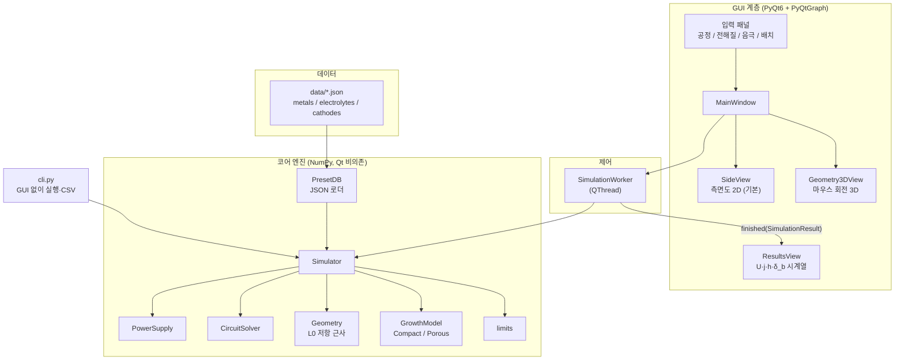
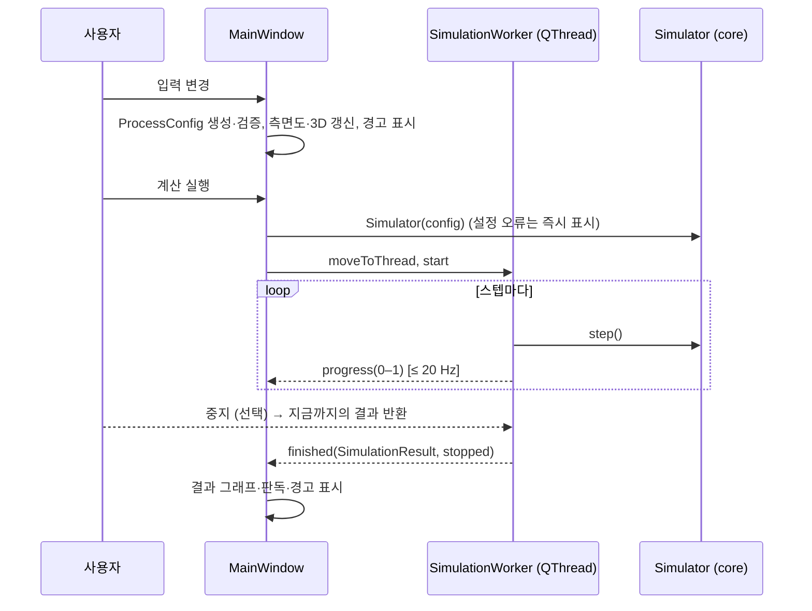
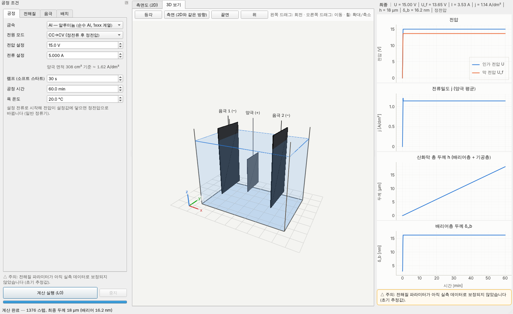

# 아노다이징 시뮬레이터 설계서 (v0.2)

> 대상: 순수 Al → Al₂O₃, 순수 Ti → TiO₂ 아노다이징 공정의 **위치별·시간별 산화막 두께** 예측 (합금은 다루지 않는다)
> 스택: Python 3.11+, PyQt6, NumPy, SciPy, PyQtGraph (+ PyOpenGL: 3D 보기)
> 상태: **P0·P1 구현 완료** — L0(0D) 물리 엔진, GUI(측면도 2D·회전 가능한 3D 보기·결과 그래프), CLI, 테스트.
> 아래 수치 파라미터는 **초기 추정값**이며, 실측 데이터를 받은 뒤 보정(calibration)하는 것을 전제로 한다.

### 변경 이력

| 버전 | 내용 |
|---|---|
| v0.1 | 수학 모델·아키텍처 초안 |
| v0.2 | 결정 사항 반영(SciPy 추가, 측면도 기본, 3D 회전 보기, 합금 제외, 실측 보정은 데이터 확보 후). P1 구현 중 발견한 두 가지 수정: 다공성 전하 분배를 **초과 전류 기준**으로 변경(§1.5-B), 시간 적분을 **stiff 대응 선형 암시적 방식**으로 변경(§1.12) |

---

## 0. 개요

### 0.1 목표
사용자가 입력한 공정 조건으로 산화막 두께 분포 $h(s, t)$를 계산하고 실시간으로 시각화한다. 여기서 $s$는 양극(피처리물) 표면을 따라가는 위치 좌표다. 입력 조건은 다음과 같다.

- 전원: 전압 $U$, 전류 $I$ (정전압 / 정전류 / 정전류→정전압)
- 전해질 레시피: 산 종류·농도, 첨가제(NH₄F, 에틸렌글리콜 등), 욕 온도
- 음극재: Pb, SUS316, Al, Ti, Pt, 흑연 등
- 공정 시간 $t$
- 양극·음극의 배치: 전해조 크기, 전극 형상, 위치, 면적 — **측면도(x–z 단면)가 기본 좌표계**이고, 3D 보기에서 마우스로 회전해 확인한다

금속은 순수 Al(1xxx 계열)과 CP Ti 만 다룬다. 합금 원소의 영향(효율·색상 변화)은 범위 밖이다.

### 0.2 모델 충실도 단계 (Level)

한 번에 모든 물리를 넣지 않고, 같은 인터페이스 위에서 단계적으로 정밀도를 올린다.

| Level | 공간 차원 | 전류 분포 계산 | 용도 |
|---|---|---|---|
| **L0** ✅ | 0D (한 점) | 없음 (단일 저항, §1.7 L0 근사) | 공정 조건 빠른 추정, 단위 테스트 기준값 — **구현됨** |
| **L1** | 양극 표면 1D ($s$) | 경로 저항 근사 (대각 행렬 $R$) | 실시간 미리보기 (기본값) |
| **L2** | 전해조 2D 단면 | 라플라스 방정식 FDM → 전해질 저항 행렬 $R$ (2차 전류 분포) | 전극 배치 효과 정밀 분석 |
| L3 (향후) | 3D, 열·유동 연성 | FEM/BEM | 연구용 확장 |

L1과 L2의 차이는 **저항 행렬 $R$을 어떻게 만드는가**뿐이다. 성장 모델, 회로 해석기, GUI는 그대로 재사용한다(§1.7).

---

## 1. 수학 모델

### 1.1 기호와 단위

내부 계산은 모두 SI 단위다. 표시할 때만 μm, nm, min, A/dm²로 변환한다.

| 기호 | 의미 | 단위 |
|---|---|---|
| $F$ | 패러데이 상수 (96485.332) | C/mol |
| $R_g$ | 기체 상수 (8.314) | J/(mol·K) |
| $j$ | 양극 국부 전류밀도 | A/m² |
| $\eta$ | 전류효율 (산화막 형성에 쓰인 전하 비율) | – |
| $M_{ox}, \rho_{ox}$ | 산화물 몰질량, 밀도 | kg/mol, kg/m³ |
| $z$ | 산화물 1 화학식단위당 전자 수 (Al₂O₃: 6, TiO₂: 4) | – |
| $k_F$ | 패러데이 성장 계수 $M_{ox}/(zF\rho_{ox})$ | m³/C |
| $\delta_b$ | 배리어(치밀)층 두께 | m |
| $h_p$ | 다공성층(또는 나노튜브) 두께 | m |
| $h$ | 총 산화막 두께 $= \delta_b + h_p$ | m |
| $P$ | 다공성층 기공률 | – |
| $U_f$ | 산화막에 걸리는 전압 | V |
| $E = U_f/\delta_b$ | 배리어층 내부 전계 | V/m |
| $A, B$ | 고전계 이온전도 상수 | A/m², m/V |
| $\kappa$ | 전해질 전도도 | S/m |
| $T$ | 욕 온도 | K |

### 1.2 전기화학 반응과 패러데이 법칙

**양극 반응 (산화막 형성)**

```math
2\,\mathrm{Al} + 3\,\mathrm{H_2O} \rightarrow \mathrm{Al_2O_3} + 6\,\mathrm{H^+} + 6\,e^- \qquad (z = 6)
```

```math
\mathrm{Ti} + 2\,\mathrm{H_2O} \rightarrow \mathrm{TiO_2} + 4\,\mathrm{H^+} + 4\,e^- \qquad (z = 4)
```

**양극 부반응 (효율 손실):** 산소 발생 $2\mathrm{H_2O} \rightarrow \mathrm{O_2} + 4\mathrm{H^+} + 4e^-$ (Ti에서 지배적), 금속 이온 용출(Al³⁺ ejection), 전자 누설 전류

**음극 반응:** $2\mathrm{H^+} + 2e^- \rightarrow \mathrm{H_2}$

**패러데이 법칙.** 전하 $dQ$가 흐르면 그중 $\eta$만큼이 산화막 형성에 쓰인다. 단위 면적당 생성되는 치밀 산화물의 부피 증가율은 다음과 같다.

```math
\frac{dV_{ox}}{dt} = \eta\,k_F\,j, \qquad k_F = \frac{M_{ox}}{z\,F\,\rho_{ox}}
```

금속 소모(표면 후퇴)는 같은 방식으로 $k_M = M_M / (z_M F \rho_M)$을 쓴다 ($z_M$: Al 3, Ti 4).

| 항목 | Al → Al₂O₃ | Ti → TiO₂ |
|---|---|---|
| $M_{ox}$ [g/mol] | 101.96 | 79.87 |
| $\rho_{ox}$ (양극산화 비정질막) [g/cm³] | 3.0–3.2 (기본 3.2) | 3.6–3.9 (기본 3.8) |
| $k_F$ (η=1, 치밀막) | **0.550 μm per C/cm²** | **0.545 μm per C/cm²** |
| 금속 후퇴 $k_M$ | 0.345 μm per C/cm² | 0.275 μm per C/cm² |
| 부피 팽창비 (PBR 유사) | ≈1.6 (ρ=3.2) | ≈2.0 (ρ=3.8) |

**검증 기준점 (산업 경험칙):** Al 황산 아노다이징의 "720 rule"(1 mil = 720 A·min/ft²)을 환산하면 **0.328 μm/(A/dm²·min)** 이다. 패러데이 식에 η=1, P=0을 넣으면 0.330, η=0.75, P=0.2를 넣으면 0.310이 나와 잘 맞는다. 이 값을 단위 테스트의 기준점으로 쓴다.

### 1.3 전류효율 η

$\eta = j_{ox}/j$이고, 기본값은 전해질 프리셋의 상수다. 필요하면 아래 선택 모델을 켠다.

```math
\eta(T, U_f) = \mathrm{clip}\!\Big(\eta_{ref}\,\big[1 + \alpha_\eta (T - T_{ref})\big] \cdot \frac{1}{1 + (U_f/U_\eta)^{n_\eta}},\; 0,\; 1\Big)
```

- Al (황산): 0.6–0.8 수준
- Ti: 산소 발생 부반응 때문에 낮고 편차가 크다(전해질·전압 의존). **반드시 보정이 필요한 파라미터**로 분류한다.

### 1.4 배리어층의 고전계 이온전도 (High-field conduction)

얇은 배리어층 안에서 이온 전류는 전계에 지수적으로 의존한다(Güntherschulze–Betz형).

```math
j = A\,\exp(B\,E) = A\,\exp\!\left(\frac{B\,U_f}{\delta_b}\right)
\quad\Longleftrightarrow\quad
U_f = \frac{\delta_b}{B}\,\ln\frac{j}{A}
```

- **구현 형태 (sinh 형):** 전류 0 근처에서도 매끄럽도록 $j = 2A\sinh(B\,U_f/\delta_b) \Leftrightarrow U_f = (\delta_b/B)\,\mathrm{asinh}(j/2A)$ 를 쓴다. $j \gg A$ 에서는 위 식과 같고, $j \to 0$ 이면 $U_f \to 0$ 이라 램프 시작·출력 0 구간에서도 Newton 해석이 안정적이다.
- $B$: 알루미나는 약 33 nm/V 수준의 전계 계수가 보고되어 있다(Ide, Mishra, Hebert, *Electrochim. Acta* 2016). TiO₂는 보정 대상이다.
- $A$는 직접 넣기보다, 측정 가능한 **양극산화비(anodizing ratio) $k_a$ [nm/V]** 와 기준 전류밀도 $j_{ref}$로부터 일관되게 유도한다.

```math
A = j_{ref}\,\exp\!\left(-\frac{B}{k_{a,ref}}\right)
```

  예: Al 배리어형 $k_a$ = 1.3 nm/V @ 10 A/m², B = 33 nm/V → A ≈ 9.5×10⁻¹¹ A/m²

- **막의 미분 저항**은 회로 해석(§1.7)과 균일성 지표(Wagner 수)에 쓰인다.

```math
r_f = \frac{\partial U_f}{\partial j} = \frac{\delta_b}{B\,j} \quad [\Omega\cdot\mathrm{m^2}]
```

### 1.5 성장 모드별 상태 방정식

양극 표면 요소 $i$마다 상태 벡터 $\mathbf{y}_i = (\delta_{b,i},\ h_{p,i},\ h_{M,i})$를 갖는다. 성장 모드는 **전략 패턴**으로 교체할 수 있게 한다(§2.5).

#### (A) 치밀(배리어)형: Ti 착색 아노다이징, Al 붕산/주석산 배리어형

```math
\frac{d\delta_b}{dt} = \eta\,k_F\,j, \qquad h = \delta_b
```

- 정전류(CC): 두께가 선형으로 증가하고, 전압이 $U_f = \delta_b \ln(j/A)/B$에 따라 따라 올라간다.
- 정전압(CV): 두께가 늘수록 전계가 약해져 전류가 지수적으로 감소한다. 두께는 $\delta_b \approx k_a U_f$로 로그적으로 수렴한다(Ti: 산성 용액에서 약 2.4–2.8 nm/V).
- 부가 출력 (Ti): 간섭색 $2\,n\,d\cos\theta = m\,\lambda$ ($n_{TiO_2} \approx 2.2$–$2.5$)으로 예상 색상을 계산한다.

#### (B) 다공성형: Al₂O₃ (황산·옥살산·인산), TiO₂ 나노튜브 (EG + NH₄F)

다공성 산화막은 "얇은 배리어층(전압에 비례) + 그 위에 자라는 다공성층"의 2층 구조다. 핵심은 정상상태에서 배리어 두께가 전압으로 정해지고, 이후의 전하는 다공성층 성장에 쓰인다는 점이다.

**① 정상상태 분극곡선 (반경험식, 프리셋에서 제공)**

```math
j_{ss}(U_f, T) = j_{ss,ref}\,\exp\!\left(\frac{U_f - U_{ref}}{U_s}\right)\exp\!\left[-\frac{E_j}{R_g}\left(\frac{1}{T} - \frac{1}{T_{ref}}\right)\right]
```

**② 정상상태 배리어 두께.** 고전계 법칙과 일관되게 유도하므로 별도 파라미터가 아니다.

```math
\delta_{ss}(U_f) = \frac{B\,U_f}{\ln\!\big(j_{ss}(U_f)/A\big)} \;\;(\approx k_b U_f,\; k_b \approx 1.0\text{–}1.3\ \mathrm{nm/V}\ \text{for Al})
```

**③ 전하 분배 (초과 전류 기준, 전하 보존형).** 정상 전류 $j_{ss}$ 를 넘는 전류만 배리어를 두껍게 하고, 정상 전류만큼은 기공층 성장에 쓰인다.

```math
\frac{d\delta_b}{dt} =
\begin{cases}
\eta\,k_F\,(j - j_{ss}) & j \ge j_{ss} \\
-\min\big(\eta\,k_F\,(j_{ss} - j),\ v_{thin}\big) & j < j_{ss}
\end{cases}
```

```math
\frac{dh_p}{dt} = \frac{\eta\,k_F\,\min(j,\ j_{ss})}{1-P} \;-\; \big(v_{cd} + k_{pw}\,h_p\big)\,[h_p > 0]
```

- 시작 직후(배리어가 얇아 $j \gg j_{ss}$)에는 거의 모든 전하가 배리어 형성에 쓰이고, $j \to j_{ss}$ 가 되면 배리어 두께는 $\delta_{ss}$ 로 유지되며 전하는 모두 기공층으로 간다.
- $v_{thin}$: 전압을 낮췄을 때($j < j_{ss}$) 배리어가 화학적으로 얇아지는 속도의 상한("전압 강하 시 전류 정지 → 회복" 거동)
- **v0.1 대비 변경:** 처음 설계한 두께비 분배 $\phi = 1 - \delta_b/\delta_{ss}$ 는 전압 램프 중 배리어 성장이 뒤처져 전류가 크게 튀는 비물리적 결과를 냈다(옥살산 40 V 램프에서 burning 한계를 넘는 6 A/dm² 피크). 초과 전류 기준으로 바꾼 뒤 피크는 1.3 A/dm² 로 줄었고 정상상태는 같다.
- $v_{cd}$: 표면 화학 용해 속도

```math
v_{cd} = v_{cd,ref}\,(C/C_{ref})^{n}\exp\!\left[-\frac{E_{cd}}{R_g}\left(\frac{1}{T}-\frac{1}{T_{ref}}\right)\right]
```

- $k_{pw}\,h_p$: 기공벽 용해항이다. 기공벽 면적은 두께에 비례하므로 이 항이 **한계 두께** $h_{max} \approx g/k_{pw}$를 만든다. 고온·묽은 산에서 분말화되는 현상을 이 항으로 표현한다.
- **TiO₂ 나노튜브**는 같은 방정식을 쓴다. $h_p$가 튜브 길이이고, $v_{cd}$와 $k_{pw}$는 [F⁻]에 의존한다.
- **부가 출력 (구조 예측):** 셀 간격 $D_{int} \approx 2.5\ \mathrm{nm/V}\times U_f$, 기공 직경 $D_p \approx 1.29\ \mathrm{nm/V}\times U_f$ (자기정렬 조건 기준 경험식)

> **한계 (v1):** 기공 핵생성 단계의 전류 극소점(current minimum)은 표현하지 않는다(전류가 단조 감소 후 정상상태로 수렴). 기공률 $P$는 프리셋 상수로 두고, 깊이별 기공 확장은 v2 과제로 둔다. 기공층 자체의 전기 저항은 무시한다(그래서 기공층 두께는 회로에 영향을 주지 않는다).

### 1.6 셀 전압 수지

양극 표면 요소 $i$에서 전원 전압은 다음과 같이 나뉜다.

```math
U_{app} = U_{off} + U_{f,i} + \Delta\phi_{el,i} + |\eta_c|
```

| 항 | 의미 | 모델 |
|---|---|---|
| $U_{off}$ | 가역 셀 전압 + 접점·버스바 저항 | 상수 + $I R_{ext}$ |
| $U_{f,i}$ | 산화막 전압 | §1.4 고전계 법칙 |
| $\Delta\phi_{el,i}$ | 전해질 IR 강하 | §1.7 저항 행렬 |
| $\eta_c$ | 음극 수소발생 과전압 | Tafel: $\lvert\eta_c\rvert = b_c \log_{10}(j_c/j_{0,c})$, $j_c = I/A_c$ |

양극 활성화 과전압은 $U_f$에 비해 무시할 만하므로 $U_f$에 흡수한다.

> **음극재가 미치는 영향:** 1 A/dm²에서 Tafel 과전압은 Pt 약 0.03 V, SUS 약 0.5 V, Ti 약 0.7 V, Pb 약 1.3 V다. 15 V Al 공정에서는 작지만, 10 V 안팎의 Ti 착색 공정에서는 무시할 수 없다. 두께 분포에는 음극재보다 **음극 면적·위치(형상)** 가 훨씬 큰 영향을 준다. 그래서 음극재는 전압 수지와 경고(오염, 용출)에 반영하고, 분포는 형상으로 계산한다.

### 1.7 공간 전류 분포: 위치별 두께를 결정하는 핵심

**지배 방정식.** 전해질 영역 $\Omega$에서 전하가 보존된다(전도도 균일 → 라플라스 방정식).

```math
\nabla\cdot(\kappa\nabla\varphi) = 0 \quad \text{in } \Omega
```

| 경계 | 조건 |
|---|---|
| 양극 $\Gamma_a$ | $-\kappa\,\partial\varphi/\partial n = j(s)$, 그리고 $U_{app} - \varphi(s) = U_{off} + U_f(j,\delta_b) + \lvert\eta_c\rvert$ (비선형) |
| 음극 $\Gamma_c$ | $\varphi = 0$ (등전위 기준). 음극 과전압은 총전류로 균일하게 묶어 처리한다(가정) |
| 벽, 액면, 마스킹 | $\partial\varphi/\partial n = 0$ (절연) |

**핵심 아이디어: 전해질 저항 행렬 $R$을 한 번만 계산한다.** 전해질은 선형이므로, 양극을 $N$개 요소(면적 $a_k$)로 나누면 요소 전류 $I_k = a_k j_k$와 요소 전위 사이에 선형 관계가 성립한다.

```math
\Delta\boldsymbol{\phi}_{el} = \mathbf{R}\,(\mathbf{a}\circ\mathbf{j}), \qquad \mathbf{R}\in\mathbb{R}^{N\times N}
```

- **L2 (FDM):** 2D 격자에서 라플라스 이산화 → 희소행렬 LU 분해 1회 → 단위 전류 $N$개를 주입해 역대입 $N$회 → $\mathbf{R}$
- **L1 (경로 근사):** 대각 행렬 $R_{ii} = L_{eff,i}/(\kappa\,a_i)$, $1/L_{eff,i} = \sum_k w_{ik}/L_{ik}$ (음극 $k$까지의 거리, 가시성 가중치 $w$). 완전히 벡터화되어 매우 빠르다.
- **온도 보정:** $\kappa$가 균일하면 $\mathbf{R}(T) = \mathbf{R}_{ref}\,\kappa_{ref}/\kappa(T)$이므로 재계산할 필요가 없다. 형상이 바뀔 때만 다시 만든다.

**L0 근사 (구현됨).** 양극 전체를 요소 1개로 보고 $\mathbf{R}$ 을 1×1 로 만든다. 양극의 좌우 두 면 각각에 대해 같은 쪽 음극은 마주보는 면 사이 거리 $L$, 반대쪽 음극은 판을 돌아가는 우회 경로($L$ + 판 두께 + 잠긴 높이/2)로 경로 길이를 잡고, 면 전도도 $\kappa A_{face}/L$ 를 모두 병렬로 더해 $R = 1/\sum G$ 를 얻는다 (`Geometry.lumped_resistance`). 음극 한쪽을 빼면 저항이 커지고 막 전압·두께가 줄어드는 경향은 이 근사에서도 나온다.

**매 시간 스텝의 비선형 연립방정식 (정전압).** 미지수를 $x_i = \ln j_i$로 잡으면 지수 항이 안정된다.

```math
G_i(\mathbf{x}) = U_{off} + \frac{\delta_{b,i}}{B}\,\mathrm{asinh}\!\Big(\frac{e^{x_i}}{2A}\Big) + \sum_k R_{ik}\,a_k e^{x_k} + \big(R_{ext} I + |\eta_c|(I)\big) - U_{app} = 0, \qquad I = \sum_k a_k e^{x_k}
```

```math
\mathbf{J} = \mathrm{diag}\!\left(\frac{\partial U_{f,i}}{\partial x_i}\right) + \Big(\mathbf{R} + R_{ext} + \frac{d|\eta_c|}{dI}\Big)\,\mathrm{diag}(\mathbf{a}\circ e^{\mathbf{x}})
```

Newton법(한 번에 $|\Delta x| \le 2$ 로 제한)과 "잔차가 커지지 않는" backtracking 을 쓴다. 전류가 거의 0 인 영역은 잔차가 평평해서 '충분한 감소' 조건을 쓰면 멈춰 버리므로 '증가하지 않음' 조건을 쓴다. 출발점은 직전 스텝 해(warm start)이고, 많이 벗어나 있으면 해석적 상한 추정 $\min(j_{저항만}, j_{막만})$ 과 비교해 가까운 쪽을 고른다. $N$ = 100–400이면 스텝당 수 ms 수준이다.

- **정전류(CC):** $U_{app}$를 미지수로 추가하고 $\sum_k a_k e^{x_k} = I_{set}$ 제약을 더한 $(N+1)$ 차 Newton.
- **CC→CV (정류기 컴플라이언스):** $I(U)$ 가 단조 증가하므로 동작점은 유일하다. 직전 스텝의 제어 모드부터 풀어 보고(대부분 한 번에 끝남), 제한을 넘으면 다른 모드로 다시 푼다. 사용자가 입력한 V와 I를 각각 설정값/제한값으로 모두 사용한다.
- **배리어 민감도:** 같은 야코비안으로 $\partial G/\partial \delta_b = \mathrm{diag}(U_f/\delta_b)$ 를 음함수 미분해 $d\mathbf{j}/d\boldsymbol{\delta}_b$, $d\mathbf{U}_f/d\boldsymbol{\delta}_b$ 를 얻는다. 시간 적분기(§1.12)가 stiff 한 배리어 식을 안정하게 푸는 데 쓴다.

**균일성 지표 (Wagner 수).** 결과 해석과 Level 선택 안내에 쓴다.

```math
Wa = \frac{\kappa\,r_f}{L} = \frac{\kappa\,\delta_b}{B\,j\,L}
```

| 조건 (L = 0.1 m) | κ [S/m] | Wa | 해석 |
|---|---|---|---|
| Al 황산 15 V, ≈1.4 A/dm² | ≈55 | **≈2** | 막 저항이 지배 → 비교적 균일 (자기 평탄화) |
| TiO₂ 나노튜브 EG + NH₄F | ≈0.05 | **≈0.002** | 전해질 저항이 지배 → 배치에 따라 두께 편차가 크다 |

즉 TiO₂ 나노튜브, 경질 아노다이징(고전류), 복잡 형상에서는 L2 필드 해석이 필수다.

### 1.8 전원 모드

| 모드 | 입력 | 동작 |
|---|---|---|
| CV | $U_{set}$, 램프 시간 $t_{ramp}$, $I_{lim}$ (제한 없음 가능) | $U_{app}(t) = U_{set}\min(1, t/t_{ramp})$, 전류 제한 시 CC로 전환 |
| CC | $I_{set}$, $U_{lim}$ (컴플라이언스) | 전류에 램프. 전압 제한 도달 시 CV로 전환 |
| CC→CV | $I_{set}$, $U_{set}$ | 일반 정류기 동작 (GUI 기본값). 전류에 램프 |
| 프로그램 (P4) | 단계 리스트 [(모드, 설정값, 시간)] | 다단 승압, 펄스 아노다이징 |

세 모드 모두 "전압 제한과 전류 제한 중 먼저 걸리는 쪽" 으로 동작한다 (§1.7). GUI 는 입력한 전류를 양극 면적으로 나눈 전류밀도(A/dm²)를 함께 보여준다.

### 1.9 온도 (선택 모듈, P4)

현재는 욕 온도를 일정하게 두고, 그 온도에서 κ·$j_{ss}$·용해 속도를 계산한다. P4 에서 욕 전체 열수지(lumped)를 더한다.

```math
\rho_{bath} V_{bath} c_p \frac{dT}{dt} = U_{app}\,I - (UA)_{cool}\,(T - T_{cool})
```

- $\kappa(T) = \kappa_{ref}\,[1 + \alpha_\kappa (T - T_{ref})]$, $\alpha_\kappa \approx 0.01$–$0.02\ \mathrm{K^{-1}}$
- $j_{ss}$, $v_{cd}$, $k_{pw}$에 아레니우스 의존성을 적용한다.
- 기공 바닥 국부 발열과 burning은 v2 과제로 둔다(현재는 경고 판정만 한다).

### 1.10 한계 판정과 경고

| 판정 | 조건 | 처리 |
|---|---|---|
| 절연파괴 / 스파크(PEO) | $U_f > U_{bd}$ (프리셋) | "모델 적용 범위 밖" 경고, 해당 요소 표시 |
| 국부 burning | $j_i > j_{burn}$ | 경질 아노다이징 모서리 경고 |
| 용해 한계 | $dh_p/dt \le 0$ | 한계 두께 도달 표시 |
| 프리셋 범위 이탈 | 농도·온도·전압이 검증 범위 밖 | 신뢰도 낮음 표시 |
| 음극재 호환성 | 전해질 태그와 음극재 비호환 태그가 겹침 (예: 불소계 + SUS) | 주의 표시, GUI 는 추천 음극으로 전환 |
| 정전류 동작 | 정류기 전류 제한에 걸린 구간 | 정보 (경고 아님) |

구현은 `core/limits.py` 이다. 실행 중 플래그는 한 번이라도 발생하면 결과에 남는다. 다공성막에서는 과전압이면 $j_{ss}$ 가 급증해 전해질 IR 강하가 대부분의 전압을 가져가므로, 절연파괴보다 burning 경고가 먼저 뜬다 (예: 황산 80 V).

### 1.11 전해질 레시피 → 모델 파라미터 매핑

레시피(성분·농도·온도)를 직접 물리량으로 바꾸는 범용 이론은 없다. 그래서 **프리셋 + 보간 + 사용자 보정** 구조로 간다. 프리셋은 JSON으로 관리해 코드 수정 없이 추가할 수 있다.

실제 파일: `src/anodsim/data/electrolytes.json` (금속 `metals.json`, 음극재 `cathodes.json`). 사람이 읽기 쉬운 단위로 쓰고 로더(`core/presets.py`)가 SI 로 바꾼다.

```json
{
  "id": "al_sulfuric_typeII",
  "name": "황산 — 일반 아노다이징 (Type II)",
  "metal": "Al",
  "regime": "porous",
  "tags": ["acid", "sulfuric"],
  "recommended_cathodes": ["pb", "al", "sus316"],
  "concentration": {"species": "H2SO4", "unit": "wt%", "ref": 15.0, "range": [10.0, 25.0]},
  "temperature_C": {"ref": 20.0, "range": [0.0, 30.0]},
  "voltage_range_V": [10.0, 25.0],
  "typical_voltage_V": 15.0,
  "conductivity": {"concentration": [10, 15, 20, 25], "S_per_m": [40, 55, 65, 72], "temp_coeff_per_K": 0.015},
  "current_efficiency": 0.70,
  "porosity": 0.15,
  "high_field": {"B_nm_per_V": 33.0, "anodizing_ratio_nm_per_V": 1.3, "j_ref_A_m2": 10.0},
  "steady_state": {"j_ref_A_m2": 150.0, "U_ref_V": 15.0, "U_s_V": 5.0, "activation_kJ_mol": 50.0},
  "dissolution": {"surface_um_per_h": 0.5, "pore_wall_per_h": 0.01, "barrier_thinning_nm_per_s": 0.05,
                  "concentration_order": 1.0, "activation_kJ_mol": 70.0},
  "limits": {"breakdown_V": 60.0, "burning_A_dm2": 5.0},
  "calibrated": false
}
```

`tags` 와 음극재의 `incompatible_tags` 가 겹치면(예: 불소계 전해질 + SUS·Pb·Al·Ti 음극) GUI·CLI 가 경고하고, 전해질을 바꾸면 GUI 는 `recommended_cathodes` 1순위로 음극을 바꿔 준다.

**전해질 프리셋 초안.** 값은 문헌·경험 범위의 초기 추정이며 `calibrated: false` 상태다.

| ID | 금속/모드 | 대표 조건 | κ [S/m] | 비고 |
|---|---|---|---|---|
| `al_sulfuric_typeII` | Al / 다공성 | H₂SO₄ 15–20 wt%, 18–22 °C, 12–20 V, 1–2 A/dm² | 50–65 | 720 rule로 검증 |
| `al_sulfuric_hard` | Al / 다공성 | H₂SO₄ 10–15 wt%, −5–5 °C, 25–75 V, 2–4 A/dm² | 35–50 | burning 경고 중요 |
| `al_oxalic` | Al / 다공성 | 0.3 M, 0–15 °C, 40 V | ≈5 | 자기정렬 40 V |
| `al_phosphoric` | Al / 다공성 | 0.3–1 M, 0–10 °C, 100–195 V | 1–3 | 큰 셀 간격 |
| `al_borate_barrier` | Al / 치밀 | 붕산·붕산암모늄, 중성 | 0.1–1 | $k_a$ ≈ 1.3–1.4 nm/V |
| `ti_color_acid` | Ti / 치밀 | H₂SO₄ 또는 H₃PO₄ 희석액, 10–100 V | 5–40 | $k_a$ ≈ 2.4–2.8 nm/V, 간섭색 |
| `ti_nanotube_eg` | Ti / 다공성 | EG + 0.3 wt% NH₄F + 2 vol% H₂O, 30–60 V | 0.02–0.1 | 배치 민감도 매우 큼 |

**음극재 프리셋 (수소발생 Tafel, 산성 기준 근사값).**

| 음극재 | $\log_{10} j_0$ [A/cm²] | $b_c$ [V/dec] | 비고 |
|---|---|---|---|
| Pt | ≈ −3.1 | 0.03 | 기준 전극 수준, 고가 |
| SUS316 | ≈ −6 | 0.12 | 범용, 불소계에서 부식 주의 |
| 흑연 | ≈ −6 | 0.12 | 불소계 대체 음극 |
| Ti | ≈ −8.2 | 0.12 | Ti 공정 동종 음극 |
| Al | ≈ −10 | 0.12 | Al 황산욕에서 사용 |
| Pb | ≈ −12.6 | 0.12 | 전통적 황산욕 음극, 과전압 큼 |

음극 입력 항목: 재질, 면적 $A_c$ (권장 양극:음극 면적비 경고 포함), 개수·위치(형상 입력과 연동)

### 1.12 시간 적분 알고리즘

**문제: 배리어 식은 매우 stiff 하다.** 전류가 배리어 두께에 지수적으로 민감해서($dj/d\delta_b \approx -j\,\ln(j/A)/\delta_b$), 정상상태 부근 이완 시간이 약 0.1 s 다(Al 황산 15 V). 처음 설계한 명시적 Heun 법은 1–4 s 스텝에서 정상상태 주변 진동(전류 ±15 %)을 일으켰다.

**해결: 배리어는 선형 암시적 오일러, 나머지는 같은 선형화 전류로 (IMEX, 전하 보존형).**

```math
J_b = \mathrm{diag}\!\Big(\frac{\partial f_b}{\partial j}\Big)\frac{d\mathbf{j}}{d\boldsymbol{\delta}_b} + \mathrm{diag}\!\Big(\frac{\partial f_b}{\partial U_f}\Big)\frac{d\mathbf{U}_f}{d\boldsymbol{\delta}_b},
\qquad
\Delta\boldsymbol{\delta}_b = (I - \Delta t\,J_b)^{-1}\,\Delta t\,\mathbf{f}_b
```

```math
\mathbf{j}_{lin} = \mathbf{j} + \frac{d\mathbf{j}}{d\boldsymbol{\delta}_b}\,\Delta\boldsymbol{\delta}_b,
\qquad \Delta Q = \Delta t\,\mathbf{j}_{lin},
\qquad \Delta h_p = \Delta t\left[\frac{\eta k_F \mathbf{j}_{lin} - \max(\Delta\boldsymbol{\delta}_b/\Delta t,\,0)}{1-P} - \text{용해}\right]
```

선형 암시적 오일러는 스텝 끝의 선형화 전류 $\mathbf{j}_{lin}$ 으로 $f_b$ 를 평가한 것과 같다. 누적 전하·기공층·금속 후퇴를 같은 $\mathbf{j}_{lin}$ 으로 적분하면 **전하 보존($\eta k_F \Delta Q$ = 배리어 증가 + 기공층 증가의 치밀 부피)이 스텝마다 기계 정밀도로 성립**한다. (처음에 전하만 사다리꼴로 적분했을 때는 두 적분법의 불일치로 Ti 정전압 돌입 구간에서 전하가 0.7 % 과대평가되었다.)

```text
initialize: δ_b = δ_native (Al 3 nm, Ti 5 nm), h_p = 0, 동작점 풀기
loop while t < t_end:
    dj, dU_f      ← circuit.barrier_sensitivity(δ_b, op)          # §1.7
    Δt            ← min(Δt_max, 0.5 %·δ_b/|f_b|, 5 %·j/|dj/dt|, 0.05/k_pw, 램프/100, 남은 시간)
    Δδ_b          ← (I − Δt·J_b)⁻¹ · Δt · f_b                    # 선형 암시적
    j_lin         ← j + dj · Δδ_b
    h_p, h_M, Q   ← j_lin 으로 갱신 (전하 보존)
    op            ← circuit.solve(δ_b, setpoint(t + Δt), prefer = 직전 모드)
    flags         ← limits.check(op, ...)
```

- 기공층은 회로에 영향을 주지 않으므로 스텝당 회로 해석은 1회다. 기본 $\Delta t_{max}$ = min(공정 시간/1000, 10 s).
- 실측 성능(L0, 1 h 공정): 1,200–1,900 스텝, 0.3–0.5 s.
- 수렴성: 허용오차를 1/4 로 줄여도 최종 두께 차이 ≤ 1.3×10⁻⁴, 누적 전하 차이 ≤ 1.4×10⁻⁴ (가장 까다로운 Ti 정전압 무램프 기준).

### 1.13 검증 (V&V) 계획

**L0 엔진 결과 (기본 배치: 40×25×35 cm 전해조, 양극 1장·좌우 음극 2장, 간격 11.75 cm)**

| 케이스 | 조건 | 결과 | 기준 |
|---|---|---|---|
| Al 황산 Type II | 15 V, Pb 음극, 20 °C, 60 min | j ≈ 1.15 A/dm², U_f = 13.65 V (음극 과전압 1.2 V), δ_b = 16.2 nm (1.19 nm/V), 18.0 μm | 실무 범위 1–2 A/dm², 약 15–25 μm/h |
| Al 경질 (Type III) | 0 °C, CC 10 A(3.2 A/dm²) → 60 V 제한 | 정전류 유지, 44.7 V, 1 h 후 53 μm | 경질 피막 25–75 V |
| Al 옥살산 | 40 V, 5 °C, 120 min | 0.28 A/dm², δ_b = 45.6 nm, 8.5 μm | 자기정렬 조건 |
| Ti 착색 | CC 0.15 A → 50 V, 10 min | δ_b = 99.7 nm @ 45.1 V (2.2 nm/V, 아직 CC 구간) | — |
| Ti 착색 | 50 V CV (10 s 램프), 10 min | δ_b = 131 nm, U_f = 49.6 V → 2.64 nm/V (전류 0.05 mA/cm² 까지 감소) | 문헌 2.4–2.8 nm/V |
| TiO₂ 나노튜브 | 60 V CV, 60 min, Pt 음극 | U_f = 49 V (전해질 IR 강하 11 V), 4.2 μm. 음극 1개만 쓰면 U_f 43.5 V, 3.1 μm | 저전도 전해질에서 배치 민감 |

**자동 테스트 (pytest 73개 통과 — `core`는 Qt 없이, GUI 는 pytest-qt 로 offscreen/Xvfb 모두)**

| # | 항목 | 상태 |
|---|---|---|
| 1 | 패러데이 계수: Al₂O₃ 0.550, TiO₂ 0.545 μm per C/cm² | ✅ |
| 2 | 720 rule 재현: η=1, P=0 → 0.328 μm/(A/dm²·min) ±2 % | ✅ |
| 3 | 전하 보존: $\eta k_F \int j\,dt$ = 생성 치밀 부피 (상대오차 1e-9), 금속 후퇴도 동일 | ✅ |
| 4 | CC 모드: $\sum a_i j_i = I_{set}$ (N=1, N=5 대칭 양의 정부호 R, 상대오차 < 1e-8) | ✅ |
| 5 | 대칭 배치 → 대칭 전류 분포 (회로 해석기 수준) | ✅ |
| 6 | Ti CV 장시간: $\delta_b/U_f \to k_a$ ±10 % | ✅ |
| 7 | L2 저항 행렬: 평행판 해석해, 대칭성 $R = R^\top$ | P3 |
| 8 | Wagner 수 극한: $\kappa \to \infty$이면 균일 분포 | P2 |
| + | 회로 민감도 = 유한차분, 정상상태 진동 없음(회귀), 시간 스텝 수렴, 모든 프리셋 실행, 절연파괴·burning 경고, 범위·음극 호환성 경고, 잘못된 설정 거부, CLI, GUI(기본값·금속 전환·형상 오류·실행·3D 드래그 회전) | ✅ |

**보정 (v2):** 실측 두께-시간 데이터를 읽어 $\eta$, $j_{ss}$ 파라미터, $v_{cd}$, $k_{pw}$를 최소제곱 피팅(`scipy.optimize.least_squares`)한 뒤 프리셋에 `calibrated: true`로 저장한다.

---

## 2. 소프트웨어 아키텍처

### 2.1 설계 원칙

1. **물리 엔진과 GUI의 완전 분리:** `core` 패키지는 PyQt를 import하지 않는다. 그래서 CLI·노트북·테스트에서 그대로 쓸 수 있다.
2. **불변 설정, 가변 상태:** `ProcessConfig`는 frozen dataclass이고, 시뮬레이션 중 바뀌는 것은 `SimState`뿐이다.
3. **전략 패턴:** 성장 모델(치밀/다공성), 필드 해석기(L1/L2), 전원 모드를 인터페이스로 정의하고 교체 가능하게 한다.
4. **데이터 주도:** 금속·전해질·음극 파라미터는 JSON 프리셋으로 관리한다. 코드를 수정하지 않고 레시피를 추가할 수 있다.
5. **SI 단위 일관성:** 변환은 `units.py`와 GUI 경계에서만 한다.
6. **실시간성:** 계산은 워커 스레드에서 하고, 화면 갱신은 30 fps 이하로 제한한다.

### 2.2 계층 구조



P2 이후에는 `FieldSolver`(L1 경로 근사 / L2 FDM)가 `Geometry` 대신 저항 행렬 $\mathbf{R}$ 을 만들고, 워커가 스냅샷을 실시간으로 흘려보낸다.

### 2.3 디렉터리 구조 (현재)

```text
Anodizing_simulator/
├── pyproject.toml                 # 패키지·의존성·진입점 (anodsim, anodsim-cli)
├── requirements.txt / requirements-dev.txt
├── README.md
├── docs/
│   ├── DESIGN.md                  # 본 문서
│   └── images/                    # GUI 스크린샷
├── src/anodsim/
│   ├── __main__.py                # python -m anodsim → GUI
│   ├── cli.py                     # python -m anodsim.cli → L0 계산·CSV
│   ├── core/                      # ── Qt 비의존 물리 엔진 ──
│   │   ├── constants.py           # F, R_g
│   │   ├── units.py               # μm↔m, A/dm²↔A/m², °C↔K
│   │   ├── materials.py           # Metal, Oxide (k_F, k_M, PBR)
│   │   ├── electrolyte.py         # ElectrolytePreset → ElectrolyteProps(T, C)
│   │   ├── cathode.py             # CathodeMaterial (HER Tafel, 호환성)
│   │   ├── geometry.py            # Tank, PlateElectrode, Geometry (측면도 좌표, 검증, L0 저항)
│   │   ├── growth/
│   │   │   ├── high_field.py      # HighFieldLaw (sinh 형, A 유도)
│   │   │   ├── base.py            # GrowthModel (패러데이, 전하 분배 규칙)
│   │   │   ├── compact.py         # 치밀형
│   │   │   └── porous.py          # 다공성형 (초과 전류 분배, 용해)
│   │   ├── power_supply.py        # CV / CC / CC→CV + 램프
│   │   ├── circuit.py             # Newton 동작점 해석 + 배리어 민감도
│   │   ├── limits.py              # 절연파괴·burning·용해 한계, 범위·음극 경고
│   │   ├── presets.py             # PresetDB (JSON → SI)
│   │   ├── state.py               # ProcessConfig, SimState, Snapshot
│   │   └── simulator.py           # Simulator (IMEX 적분), SimulationResult
│   ├── data/                      # metals.json, electrolytes.json(7종), cathodes.json(6종)
│   └── gui/
│       ├── app.py                 # QApplication, pyqtgraph 설정
│       ├── main_window.py         # 입력 도크 + [측면도|3D] + 결과
│       ├── worker.py              # SimulationWorker (QThread, 진행률·중지)
│       ├── style.py               # 색상 (색각 이상 검증된 시리즈 순서)
│       ├── panels/                # process / electrolyte / cathode / geometry
│       └── views/
│           ├── side_view.py       # 측면도 (x–z), 극간 거리 표시
│           ├── view3d.py          # GLViewWidget 3D, 시점 프리셋, 투영 라벨
│           └── results_view.py    # 4단 시계열 + 십자선 판독 + 경고
└── tests/                         # pytest 73개 (core 68 + GUI 5)
```

P2 이후 추가 예정: `core/field/`(L1·L2 저항 행렬), `core/thermal.py`, `io/`(프로젝트 저장·내보내기), `gui/views/`의 위치별 프로파일·히트맵·Ti 간섭색.

### 2.4 핵심 데이터 모델 (구현)

```python
@dataclass(frozen=True)
class PowerSetting:
    mode: PowerMode            # CV | CC | CCCV
    voltage: float             # V — CV/CCCV 설정값, CC 에서는 제한값
    current: float             # A — CC/CCCV 설정값, CV 에서는 제한값 (math.inf = 제한 없음)
    ramp_time: float = 0.0     # s — CV 는 전압, CC·CCCV 는 전류에 램프

@dataclass(frozen=True)
class PlateElectrode:          # y–z 평면에 평행한 판, ±x 면이 마주본다
    x_center: float; z_bottom: float; height: float; thickness: float; width: float
    y_center: float | None = None          # None = 전해조 깊이 중앙

@dataclass(frozen=True)
class Geometry:
    tank: Tank                             # width(x), depth(y), height(z), liquid_level
    anode: PlateElectrode
    cathodes: tuple[PlateElectrode, ...]

@dataclass(frozen=True)
class ProcessConfig:
    metal: str                             # "Al" | "Ti"
    electrolyte: ElectrolyteRecipe         # preset_id + 농도
    cathode_material: str
    power: PowerSetting
    geometry: Geometry
    bath_temperature: float                # K
    duration: float                        # s
    fidelity: str = "L0"
    offset_voltage: float = 0.0            # V
    external_resistance: float = 0.0       # Ω

@dataclass
class SimState:                            # 요소별 배열 (L0: 길이 1)
    time: float
    barrier: np.ndarray; porous: np.ndarray; metal_loss: np.ndarray; charge: np.ndarray

@dataclass(frozen=True)
class Snapshot:                            # GUI 로 넘기는 불변 사본
    time: float; voltage: float; current: float; control: str; cathode_overpotential: float
    current_density, film_voltage, barrier, porous, total, metal_loss, charge: np.ndarray
    flags: frozenset[str]
```

### 2.5 핵심 인터페이스 (구현)

```python
class GrowthModel(ABC):                                   # growth/base.py
    def film_voltage(self, j, barrier): ...               # U_f (고전계, sinh 형)
    def d_film_voltage_d_lnj(self, j, barrier): ...       # Newton 야코비안
    def rates(self, j, U_f, barrier, porous) -> GrowthRates: ...   # 공통 전하 분배
    @abstractmethod
    def barrier_rate(self, j, U_f, barrier): ...          # f_b
    @abstractmethod
    def barrier_rate_partials(self, j, U_f, barrier): ... # (∂f_b/∂j, ∂f_b/∂U_f)
    @abstractmethod
    def porous_rate(self, pore_formation, porous): ...    # dh_p/dt

class CircuitSolver:                                      # circuit.py
    def solve(self, model, barrier, setpoint, guess=None, prefer="CV") -> OperatingPoint: ...
    def barrier_sensitivity(self, model, barrier, op) -> tuple[np.ndarray, np.ndarray]: ...

class Simulator:                                          # simulator.py
    def __init__(self, config, presets=None, *, max_step=None,
                 barrier_tolerance=0.005, current_tolerance=0.05): ...
    def reset(self) -> None: ...
    def step(self) -> Snapshot: ...
    def run(self, callback=None) -> SimulationResult: ...  # callback 이 False 를 주면 중지
```

P2 에서 추가: `FieldSolver.resistance_matrix(mesh, κ) -> (N, N)` (L1 경로 근사 / L2 FDM + `scipy.sparse.linalg.splu`).

### 2.6 실행 흐름 (현재: L0)



### 2.7 스레딩

- 계산은 `SimulationWorker(QObject)` 를 `QThread` 로 옮겨 실행한다. 시그널: `progress(float)`, `finished(object, bool)`, `failed(str)`.
- 실행 중에는 입력 탭을 잠그고, '중지'를 누르면 콜백이 `False` 를 돌려 적분을 멈춘 뒤 그때까지의 결과를 보여준다.
- L0 는 1 h 공정이 0.3–0.5 s 라 결과를 한 번에 그린다. P2(L1, N≈200)부터는 스냅샷을 30 Hz 이하로 흘려 실시간 갱신하고 배속(예: 60×)을 지원한다.

### 2.8 GUI 레이아웃 (현재)




```text
┌─ 공정 조건 (도크) ─┬─[측면도 (2D)]─[3D 보기]────────┬─ 결과 ─────────────────────┐
│ [공정|전해질|음극|배치] │                             │ 판독: t · U · U_f · I · j · h · δ_b │
│  금속 Al/Ti        │   측면도: 전해조·액면·전극,      │ ┌ 전압 U, U_f ───────────┐ │
│  전원 모드·V·I     │   행거, 극간 거리 표시          │ ├ 전류밀도 j ─────────────┤ │
│  램프·시간·온도    │                                 │ ├ 산화막 두께 h ──────────┤ │
│  (전류밀도 환산)   │   3D: 왼쪽 드래그 회전,          │ ├ 배리어층 두께 δ_b ──────┤ │
│ 입력 오류·주의     │   오른쪽 드래그 이동, 휠 확대     │ └ 시간 [min] (공유 축) ───┘ │
│ [계산 실행] [중지] │   시점: 등각·측면·끝면·위       │ 경고·주의                   │
└────────────────────┴─────────────────────────────────┴─────────────────────────────┘
 상태바: 양극·음극 면적 · κ · 전해질 저항(L0)
```

| 위젯 | 구성 | 비고 |
|---|---|---|
| SideView | `pg.PlotWidget`, 비율 고정, `QGraphicsRectItem` | 기본 보기. 측면도 좌표(x 가로, z 높이) |
| Geometry3DView | `gl.GLViewWidget` 상속 `OrbitView`, `GLMeshItem`(전극·전해질), `GLLinePlotItem`(전해조·축) | 라벨은 3D 점을 화면에 투영한 `QLabel` (OpenGL 텍스트는 환경에 따라 안 보일 수 있어 대체) |
| ResultsView | `pg.PlotWidget` × 4, 시간축 연동, `InfiniteLine` 십자선 | 축 하나에 단위 하나 (이중 축 없음), 시리즈 2개 이상일 때만 범례 |

**3D 보기 조작:** 왼쪽 드래그 = 회전(궤도), 오른쪽 또는 가운데 드래그 = 이동(Ctrl + 왼쪽도 가능), 휠 = 확대/축소. 시점 버튼 '측면 (2D와 같은 방향)' 은 −y 쪽에서 +y 를 보는 방향(방위각 −90°)이라 측면도와 같은 화면이 된다. 형상을 바꿔도 사용자가 돌려 놓은 시점은 유지된다.

### 2.9 입력 검증

- `ProcessConfig.validate()` 와 `Geometry.validate()` 가 물리적 범위(양수, 전해조 이탈, 전극 겹침, 잠김 여부, 음극 최소 1개, 금속–전해질 일치)를 점검한다. 오류가 있으면 실행 버튼이 꺼지고 도크 아래에 빨간 '오류'로 표시된다.
- `limits.range_warnings()` 는 프리셋 검증 범위(온도·농도·전압) 이탈, 음극재 호환성, 미보정 상태를 '주의'로 알린다 (실행은 가능).

### 2.10 파일 입출력

- 현재: CLI `--csv` 로 시간 이력 CSV 저장.
- P4: 프로젝트 파일(`*.anod.json`: `ProcessConfig` + 프리셋 override), GUI 내보내기(시계열·프로파일 CSV, PNG).

### 2.11 의존성

| 패키지 | 용도 | 비고 |
|---|---|---|
| numpy | 전체 수치 계산 | 필수 |
| scipy | L2 희소행렬 LU (`scipy.sparse.linalg.splu`), 보정 피팅 (`optimize.least_squares`) | 필수 (의존성에 추가됨, 실제 사용은 P3·P5부터) |
| PyQt6 | GUI | 필수 |
| pyqtgraph | 2D 그래프·3D 보기 | 필수 |
| PyOpenGL | 3D 보기 (`pyqtgraph.opengl`) | 필수. 없으면 3D 탭에 안내 문구만 나오고 나머지는 동작 |
| pytest, pytest-qt | 테스트 | 개발용 (`requirements-dev.txt`) |

### 2.12 테스트 전략

- `core`: 순수 pytest. §1.13 의 물리 검증 케이스를 회귀 테스트로 고정했다.
- `gui`: pytest-qt 로 기본값, 금속 전환 시 프리셋·음극 필터링, 형상 오류 시 실행 차단, 실행 종단 간, 3D 드래그 회전을 확인한다. 디스플레이가 없으면 Qt offscreen 플랫폼으로 실행된다(`tests/conftest.py`).

### 2.13 개발 로드맵

| 단계 | 산출물 | 상태 |
|---|---|---|
| **P0** 골격 | 패키지 구조, `pyproject.toml`, 상수·단위·프리셋 로더, GUI 창 | ✅ 완료 |
| **P1** L0 엔진 | 패러데이, 고전계, 치밀/다공성 모델, 전원 모드, IMEX 적분, CLI, 측면도·3D 보기·결과 그래프 | ✅ 완료 (§1.13 테스트 1–6) |
| **P2** L1 + 실시간 | 표면 이산화, 경로 저항 행렬, 위치별 두께 h(s, t), 실시간 스냅샷·배속, 3D 양극 표면 두께 색칠, 프로파일·히트맵 | 다음 단계 |
| **P3** L2 + 배치 편집 | FDM 라플라스 + SciPy 희소 LU, 측면도에서 전극 드래그 배치, 전위장 표시 | 예정 |
| **P4** 확장 | 열수지, 프로그램 전원, Ti 간섭색, 프로젝트 저장·내보내기 | 예정 |
| **P5** 보정 | 실측 두께-시간 데이터 피팅 도구, `calibrated` 프리셋 | 실측 데이터 확보 후 |

### 2.14 결정 사항 (v0.2 확정)

1. **SciPy:** 의존성에 추가한다.
2. **2D 단면 기준면:** 옆에서 본 **측면도(x–z)** 가 기본이다. 깊이 방향(y)은 3D 보기에서 확인한다.
3. **3D 보기:** 마우스 드래그로 회전·이동·확대가 되는 3D 보기를 제공한다 (P1 에서 형상 표시, P2 에서 양극 표면 두께 색칠 예정).
4. **합금:** 다루지 않는다. 순수 Al(1xxx 계열)과 CP Ti 만 대상이다.
5. **실측 데이터:** 확보 후 추가하기로 했다. 그때까지 프리셋은 `calibrated: false` 이고, GUI·CLI 는 이를 '주의'로 표시한다. P5 보정 도구는 데이터가 들어오면 진행한다.

---

## 3. 참고 문헌 및 근거

- Faraday's laws of electrolysis: 반응 전하수, 성장 계수 (§1.2)
- "720 rule" (황산 아노다이징 실무 경험칙, 720 A·min/ft² per mil): 패러데이 모델 검증 기준점
- Güntherschulze & Betz 고전계 이온전도 법칙. Ide, Mishra, Hebert, *Electrochimica Acta* (2016): 알루미나 전계 계수 약 33 nm/V
- Keller, Hunter, Robinson, *J. Electrochem. Soc.* (1953): 다공성 알루미나 셀 구조, 배리어층 약 1 nm/V
- 다공성 알루미나 셀 간격 약 2.5 nm/V, 기공 직경 약 1.29 nm/V, 자기정렬 전압(황산 25 V, 옥살산 40 V, 인산 195 V) 관련 리뷰 문헌
- Ohtsuka, Masuda, Sato, *J. Electrochem. Soc.* (1985): Ti 양극산화막 엘립소메트리, H₂SO₄에서 2.4 nm/V, 인산염에서 2.8 nm/V
- 수소발생 교환전류밀도 ($j_0$) 데이터: Trasatti volcano plot 계열 문헌 (음극재 근사값)

> 전해질별 수치(κ, $j_{ss}$, $v_{cd}$, $k_{pw}$, η)는 공정 범위 기반 **초기 추정값**이다. 실제 사용 전 원문 확인과 실험 보정이 필요하다.
